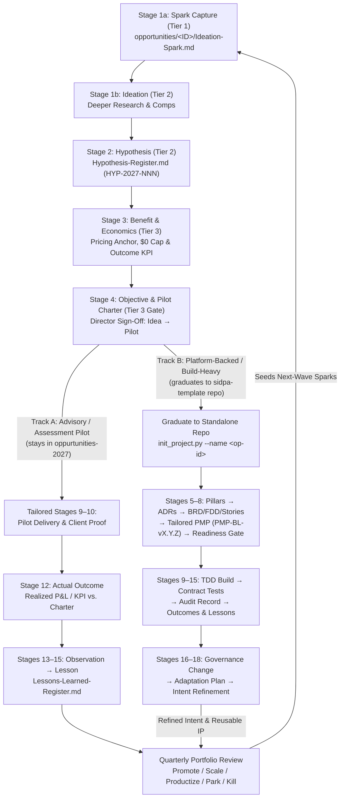

# Tailored Hybrid SIDPA Governance — Opportunities 2027

> **Owner:** Menno Drescher (Director, CBa Consult)  
> **Adapted From:** `sidpa-template` (`mdresch/sidpa-template` — Synthetic Intent-Driven Process Architecture, PMBOK 8 / BABOK)  
> **Companion Rules & Registers:** [Rules-of-Engagement.md](Rules-of-Engagement.md) · [.github/instructions/sidpa-portfolio-qa.instructions.md](../../.github/instructions/sidpa-portfolio-qa.instructions.md) · [Portfolio-Status-Register.md](../registers/Portfolio-Status-Register.md) · [Hypothesis-Register.md](../registers/Hypothesis-Register.md) · [Lessons-Learned-Register.md](../registers/Lessons-Learned-Register.md)

---

## 1. Purpose & Negative Scope Boundary

This document defines the **stages, artifacts, completion gates, and tailoring rules** governing how opportunities move from raw **Spark** to paid **Pilot** and **Scale** under a **10–15 hrs/week** capacity cap and **\$0 initial working capital**.

### What This Governance Model Is Not
- **Not a full 18-stage software-build scaffold inside `oppurtunities-2027`.** All 117 opportunity folders in [opportunities/](../../opportunities/) remain lightweight pre-project workspaces. Do not copy 9 PMBOK subsidiary plans, ADR/BRD/FDD suites, or `agent-learning` policy stores into `opportunities/<ID>/`.
- **Not a replacement for [inventory-of-ideas.md](../../inventory-of-ideas.md).** Authoritative status, effort, capital, and target-quarter fields stay in the inventory; authoritative delivery sequencing stays in [Tier_A_Executive_Summary_2027.md](../../Tier_A_Executive_Summary_2027.md).
- **Not automated approval.** Every stage gate defaults to `requires_human_approval: true` (Director sign-off).

---

## 2. End-to-End Hybrid Lifecycle Architecture

---

## 3. Funnel Stages & Completion Gates (Inside `oppurtunities-2027`)

All 117 opportunities begin in **Stage 1a**. Advancement is selective — only shortlisted candidates invest effort in Stages 1b–4.

### Stage 1a — Spark Capture (`Tier 1: Macro Signal Check`)
- **PMBOK 8 Alignment:** Initiating — Pre-Project / Strategic Need Identification.
- **Primary Artifact:** `opportunities/<ID>/Ideation-Spark.md` + row in [inventory-of-ideas.md](../../inventory-of-ideas.md).
- **Inputs:** Strategic driver, 2027 regulatory/market trigger, existing CBa Consult IP.
- **Required Content:** 1-sentence Positioning statement, draft **7 Pivotal Questions** ([ideation-template.md §6b](../../ideation-template.md#6b-standard-opportunity-brief-7-pivotal-questions)), effort/capital/quarter estimate, market-validation signal (`🟢/🟡/🔴`), and explicit scope boundary.
- **Completion Gate (`G1a` — Spark Complete):**
  - [ ] Dedicated folder exists under `opportunities/<ID>/` and is indexed in [opportunities/README.md](../../opportunities/README.md).
  - [ ] Mapped to 1 of the 17 Pillars, 1 of the 18 Signature Toolkits, and a Tier (`A–D`).
  - [ ] Problem stated before solution; no premature architecture or code specs collapsed into the Spark.
  - [ ] Inventory `Status` remains `Idea` (or `Parked`).

### Stage 1b — Ideation (`Tier 2: Deeper Internal & Competitive Research`)
- **PMBOK 8 Alignment:** Initiating — Opportunity Framing.
- **Primary Artifact:** `opportunities/<ID>/Ideation-Document.md` (or expanded research notes in the opportunity folder) + optional client-facing One-Pager (`One_Pager_<ID>_*.md`).
- **Inputs:** Completed Stage 1a Spark, internal CBa Consult assets (`OneDrive - CBA`, existing repos), [market-analysis-2027.md](../../market-analysis-2027.md).
- **Completion Gate (`G1b` — Ideation Ready):**
  - [ ] Existing internal IP covering ≥70% of the deliverable is verified (not assumed).
  - [ ] 2–3 real market comparables (pricing, packaging, buyer persona) are benchmarked.
  - [ ] Differentiation vs. generic AI templates and Big Four / MSP / MSSP boundaries are explicit.

### Stage 2 — Hypothesis (`Tier 2: Falsifiable Assumptions`)
- **PMBOK 8 Alignment:** Initiating — Pre-Project: Design & Commercial Assumption Formulation.
- **Lifecycle IPO:** *Inputs:* Stage 1b Ideation assumptions & market comps → *Process:* Formulate falsifiable hypotheses, execute minimal $0 tests, and classify objectively against empirical evidence → *Outputs:* Classified `HYP-2027-NNN` rows in [Hypothesis-Register.md](../registers/Hypothesis-Register.md) + linked evidence logs feeding Stage 3.

#### Hypothesis-Writing Best Practices (The 5-Part Falsifiable Contract)
Every hypothesis must isolate **one** testable riskiest assumption and follow the structured formula:
> *"We believe **[Target Buyer / Segment]** will **[Observable Commitment / Behavior]** because **[Specific Pain / Trigger]**. We will know this is true when **[Quantitative Success Threshold & Sample Size]** within **[Time Box]**, and false if **[Explicit Falsification Criteria]**."*

- **Four Hypothesis Types:**
  1. **Desirability (Value / Wedge):** Does the buyer experience the pain urgently enough to act?
  2. **Viability (Pricing / Economics):** Will they pay the target anchor under \$0-capital terms?
  3. **Feasibility (IP / Delivery):** Does existing CBa Consult IP cover ≥70% within the 10–15 hrs/wk cap?
  4. **Scalability (Retainer / Reuse):** Does Pilot #1 convert into repeat sales, productized IP, or an MIP retainer?
- **Anti-Patterns Rejected at `G2`:** Unfalsifiable wishes (*"clients will value this"*), bundled multi-variable statements (testing buyer + price + delivery in one row), vanity metrics (likes/impressions instead of qualified calls, LOIs, or paid pilots), and rewriting historical statements instead of appending dated updates.

#### Objective 4-Step Process *(aligned with `sidpa-template` `Stage-02-Hypothesis-Methodology`)*
1. **Formulate & Register:** Add permanent `HYP-2027-NNN` row(s) in [Hypothesis-Register.md](../registers/Hypothesis-Register.md). Keep all hypotheses in this single register (no per-ID `HYP-*.md` files); IDs are never reused or renumbered.
2. **Define Minimal Test Plan (`advance_to_testing`):** Specify the \$0-capital test method (e.g., 15 targeted outreach conversations, one-pager walkthroughs, internal IP-gap audit), sample size, time box, and evidence artifact before moving status from `Formulated` → `Testing`.
3. **Collect Empirical Evidence (No Plausibility Arguments):** Record dated, observable evidence only. If testing cannot run because a named prerequisite or external data is missing, state the blocker and hold at `Formulated/Blocked` (`remain_formulated_blocked`).
4. **Classify Status Objectively (6-Action SIDPA Lifecycle):**
   - `advance_to_testing` → **`Testing`** (real, actionable test plan is active)
   - `mark_validated` → **`Validated`** (empirical evidence meets the pre-stated Success Threshold)
   - `mark_invalidated` → **`Invalidated`** (empirical evidence triggers Falsification Criteria)
   - `mark_inconclusive` → **`Inconclusive`** (real evidence exists but does not clearly decide either way)
   - `remain_formulated_blocked` → **`Formulated/Blocked`** (no test run yet, or blocked by a named prerequisite)
   - `flag_for_human_review` → **`Human Review`** (evidence is ambiguous; escalate to Director rather than forcing a confident-looking status)

#### Stage 2 Deliverables
1. **Registered Hypothesis Row(s):** `HYP-2027-NNN` in [Hypothesis-Register.md](../registers/Hypothesis-Register.md) with Type, Statement, Test Plan & Sample, Success Threshold, Falsification Criteria, Evidence Log, and Status.
2. **Evidence Artifact(s):** Concrete, dated test log inside `opportunities/<ID>/` (e.g., outreach/discovery tally, pricing-objection notes, or IP-readiness audit) cited by the register row.
3. **Stage 3 Handoff Signal:** Clear classification showing which assumptions are `Validated` vs. still open risk for the Stage 3 Business Case.

#### Completion Gate (`G2` — Hypotheses Ready for Stage 3)
- [ ] Every riskiest assumption (at minimum 1 Value/Wedge and 1 Pricing or Feasibility hypothesis for Tier A candidates) is logged in [Hypothesis-Register.md](../registers/Hypothesis-Register.md) using the 5-part falsifiable contract.
- [ ] Each row defines a concrete **Test Plan & Sample**, **Success Threshold**, and **Falsification Criteria** (no vanity metrics or bundled variables).
- [ ] Status is honestly assigned (`Formulated` until an active test plan exists; never `Validated` without linked empirical evidence).
- [ ] *SIDPA Rule #5:* Untested or `Invalidated` hypotheses are never carried into Stage 3–4 as settled requirements or delivery commitments.

### Stage 3 — Benefit & Economics (`Tier 3: Commercial Viability`)
- **PMBOK 8 Alignment:** Initiating — Benefits Realization Planning (Charter Input — SIDPA Rule #1).
- **Primary Artifact:** Benefits & Economics section inside `opportunities/<ID>/Pilot-Charter.md` (or standalone `Business-Case.md` for Tier A enterprise offers).
- **Inputs:** Stage 2 Hypotheses, target buyer budget, 10–15 hrs/wk capacity cap.
- **Completion Gate (`G3` — Economics Approved):**
  - [ ] Confirms **\$0 initial cash outlay** and sweat-equity feasibility (≤4–6 wks at 5–10 hrs/wk for Phase 0; 6–10 wks at 8–12 hrs/wk for Tier A).
  - [ ] Pricing anchor, payment terms, and single measurable client outcome KPI (P&L, time saved, or compliance proof) are defined.
  - [ ] Compounding/reinvestment path (Case Study #1, reusable playbook, or MIP retainer graduation) is stated.

### Stage 4 — Objective & Pre-Pilot Charter (`Tier 3 Gate: Idea → Pilot`)
- **PMBOK 8 Alignment:** Initiating — 4.1 Develop Project Charter.
- **Primary Artifact:** `opportunities/<ID>/Pilot-Charter.md` (1–2 pages) + updated `Status = Pilot` in [inventory-of-ideas.md](../../inventory-of-ideas.md) and [Portfolio-Status-Register.md](../registers/Portfolio-Status-Register.md).
- **Inputs:** Stage 3 Benefits & Economics, Stage 2 Hypotheses, named pilot sponsor/prospect.
- **Completion Gate (`G4` — Pre-Pilot Authorization Gate · `requires_human_approval: true`):**
  - [ ] All 7 Pivotal Questions finalized with concrete scope and **explicit out-of-scope boundaries** (e.g., non-legal advice, non-accredited ISO 42001 readiness, non-MSP/MSSP RACI).
  - [ ] Named pilot client/prospect or concrete outreach campaign exists.
  - [ ] **Execution Track selected explicitly:** **Track A (Lightweight Advisory)** or **Track B (Graduated `sidpa-template` Build)**.
  - [ ] **Director Sign-Off recorded** before changing inventory status from `Idea` → `Pilot`.

---

## 4. Post-Charter Execution Tracks (Hybrid Tailoring Split)

Per `sidpa-template` (`docs/sequence-and-lessons.md` Rules #30 and #32), governance rigor scales with **build complexity and uncertainty** — never as one-size-fits-all bureaucracy.

### Track A: Lightweight Advisory / Assessment Pilots *(Stays in `oppurtunities-2027`)*
**Best fit:** Advisory sprints, diagnostics, maturity assessments, and toolkit deliveries with no custom software build (e.g., `OP-OPS-001 → OP-CX-001`, `OP-FIN-009`, `OP-HR-002`, `OP-RSK-004` readiness).

| Tailored Stage | Artifact (in `opportunities/<ID>/` or `docs/registers/`) | Completion Gate |
| --- | --- | --- |
| **Stages 9–10: Delivery & Client Proof** | Client deliverable(s) + delivery checklist against `Pilot-Charter.md` | Client accepts deliverable; scope boundaries respected; time & revenue logged. |
| **Stage 12: Actual Outcome** | Post-pilot outcome note (hours spent, revenue realized, client KPI achieved vs. Charter) | Empirical variance recorded honestly; `HYP-2027-NNN` status updated in [Hypothesis-Register.md](../registers/Hypothesis-Register.md). |
| **Stages 13–15: Observation → Lesson** | Entry (`LL-2027-NNN`) in [Lessons-Learned-Register.md](../registers/Lessons-Learned-Register.md) | Root cause & actionable rule accepted by Director; Tier 2/3 propagation target named (and synced to Obsidian Second Brain if cross-project). |
| **Quarterly Review (Tailored Stages 17–18)** | Quarterly update in [Portfolio-Status-Register.md](../registers/Portfolio-Status-Register.md) & [inventory-of-ideas.md](../../inventory-of-ideas.md) | Decision recorded: **Scale / Productize**, **Reinvest into Tier A / MIP**, **Park**, or **Kill**. |

*Deliberately skipped on Track A:* Pillars Exercise, ADRs, BRD/FDD/User Stories, 9 PMBOK subsidiary plans, Foundation Packs, and Bayesian `agent-learning` policy stores.

---

### Track B: Platform-Backed / Build-Heavy Flagships *(Graduates to Standalone `sidpa-template` Repo)*
**Best fit:** Software platforms, multi-agent architectures, sovereign/cryptographic runtimes, or multi-epic product builds (e.g., `OP-ITG-013`, `OP-ITG-014`, `OP-ITG-015`, `OP-ITG-016`, `OP-ITG-017`, `OP-ITG-018` tooling).

**Graduation Gate (`G4-B` — Repo Instantiation):**
1. Create a dedicated repository from `mdresch/sidpa-template` and run `python scripts/init_project.py --name <op-id>`.
2. Seed its Stage 1–4 docs directly from `opportunities/<ID>/` (citing upstream, no duplication).
3. Link the graduated repo URL in [Portfolio-Status-Register.md](../registers/Portfolio-Status-Register.md) §1.

| SIDPA Stage(s) | Core Artifacts (in Graduated Repo) | Governing Gate / Policy |
| --- | --- | --- |
| **Stage 5: Pillars & Architecture** | `PILLARS-EXERCISE.md`, `Project-Pillars.md`, foundational `ADR-*.md` (100% pillar coverage) | `approve-project-pillars`, `approve-adr` |
| **Stage 6: Requirements & Work Packages** | Strictly ordered `ADR → BRD → FDD → User Stories` (User Stories = PMBOK Work Packages) | `approve-adr`, `approve-brd`, `approve-fdd`, `approve-user-stories` |
| **Stage 7: Tailored PMP & Baselines** | Subsidiary plans (tailored; Foundation Packs only if complexity requires — Rule #30) + integrated `Project-Management-Plan.md` (`PMP-BL-vX.Y.Z`) | `approve-subsidiary-plan`, `approve-pmp` |
| **Stage 8: Implementation Readiness** | `Stage-8-Implementation-Authorization-Notice.md` + prerequisite verification | `validate-intent-foundation` (`FULL` authority; never skip) |
| **Stages 9–10: Deliverable & Verification** | Contract-first TDD implementation (`implement-story`) + full regression test suite (`heal-contract-failure`) | Full contract suite green (all areas, every time — Rule #26) |
| **Stage 11: Audit Record** | `Audit-Register.md` (`GOV-EX-###` gate-closure entries) | `approve-audit-record` |
| **Stages 12–15: Outcomes & Knowledge** | Post-delivery impact + `OBS-nnnn` → `INSIGHT-nnnn` → `Lesson-nnnn` (synced to shared Obsidian Second Brain) | Empirical baseline comparison + `resolve-kb-conflict` (shared vault) |
| **Stage 16: Governance Change** | Governance amendments (`GC-*.md`) with explicit `evidence_basis: design_time | execution` | Paired pipeline: `classify-diff-type` (`FULL`) → `escalate-diff-response` (`LOW`, with Permanent Lineage Freeze) |
| **Stage 17: Adaptation Plan** | `Adaptation-Plan.md` with 9-plan Impact Matrix (execution evidence only; minor bump `PMP-BL-v1.1.0`) | `approve-adaptation-plan` + deterministic rollback (`compare_decision_results()`) |
| **Stage 18: Intent Refinement** | `Intent-Refinement-Proposal.md` closing the phase and feeding next-phase Sparks back to `oppurtunities-2027` | `approve-intent-refinement` |

---

## 5. Two-Loop Change Control (Kept Strictly Separate)

Borrowed directly from `sidpa-template` (`docs/chain-coverage.md` §3 & §3.1):

| Loop | Trigger (`evidence_basis`) | Where Logged | Allowed Action | Prohibited Action |
| --- | --- | --- | --- | --- |
| **Design-Time Loop** | Document contradictions, ranking/quarter mismatches, scope flags found *before* pilot execution (`design_time`) | `BFI-NNN` table in [Portfolio-Status-Register.md](../registers/Portfolio-Status-Register.md) §3 | Reconcile docs & record Director decision; patch-level fix only. | Never log as a Lesson Learned; never fabricate market/execution evidence. |
| **Execution Loop** | Real client discovery, pilot delivery, revenue/time actuals, or audit findings (`execution`) | `LL-2027-NNN` in [Lessons-Learned-Register.md](../registers/Lessons-Learned-Register.md) + [Hypothesis-Register.md](../registers/Hypothesis-Register.md) | Update pricing/scoping rules, propagate Tier 2/3 invariants, feed Quarterly Review. | Never overwrite historical hypothesis statements or erase failed pilots. |

---

## 6. Standing Governance Invariants

1. **Human Adjudication Default:** `requires_human_approval: true` applies to every `Idea → Pilot` promotion, commercial re-ranking, and repo graduation.
2. **Honest Evidence Baseline:** Zero fabricated validation scores, client metrics, or Bayesian episodes (SIDPA Rules #18–19).
3. **Live Orientation:** Keep [Portfolio-Status-Register.md](../registers/Portfolio-Status-Register.md) updated at every milestone or natural pause (SIDPA Rules #23–24).
4. **No Premature Policy Stores:** Keep `agent-learning` TaskPolicies inside graduated Track B repos; only introduce automated portfolio policies here if a repeating gate decision genuinely warrants it (SIDPA Rule #18).
