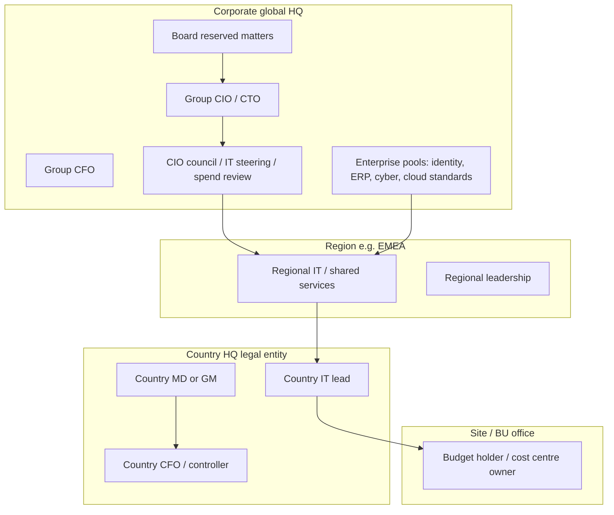

# Enterprise IT Budget & Spending Governance — Multinational Corporations

**Purpose:** Clarify how **large corporations** allocate and approve **IT and related consulting spend** across **global HQ**, **region**, **country legal entity**, and **local site**—including **budget cycles**, **ad hoc funding**, and **local vs group compliance mandates**. Use for GTM discovery, proposal routing, and sizing offers (especially vs procurement thresholds).

**Portfolio links:**

| `OP-*` | Use of this document |
| --- | --- |
| [`OP-ITG-002`](../../inventory-of-ideas.md) (#15) + [ICT-Governance-Framework-Application](https://github.com/CBA-Consult/ICT-Governance-Framework-Application) | Maps **decision rights, DoA, and governance forums** to ICT maturity gaps |
| [`OP-SCM-003`](../../opportunities/OP-SCM-003_Procurement_Readiness_Assessment_Portal/Ideation-Spark.md) | **PRMAP** — sponsor delegation before PO; approval path questionnaire |
| Phase 0 wedges | Pricing vs committee thresholds — [market-analysis-2027.md §3 Benelux anchors](../../market-analysis-2027.md) |

**Read with:** [Analyst-Signals-2027.md](Analyst-Signals-2027.md) · [Consulting-Offerings-2027.md](Consulting-Offerings-2027.md) · [Regulatory-Findings-and-Service-Gap-Analysis-2026-2027.md](Regulatory-Findings-and-Service-Gap-Analysis-2026-2027.md)

**Confidence key:** 🟢 multiple independent sources agree, or a named, dated analyst/regulatory source · 🟡 single vendor source, secondhand citation, or sources conflict · 🔴 no usable 2027-specific quantitative data found (client discovery required).

**Limits:** Thresholds, committee names, and fiscal calendars **vary by company**. This doc describes **typical** matrix/federated enterprises—not a single playbook.

---

## 1. Two structures you must not conflate

| Structure | What it governs | Typical artefacts |
| --- | --- | --- |
| **Legal / entity** | Who may **sign** contracts; tax; labour law; local filings | Articles, powers of attorney, local board |
| **Management** | Who **proposes and approves** spend; cost centres; PO workflow | DoA matrix, IT steering, procurement policy |

A **country subsidiary** can be a separate legal person while **IT, security, and procurement** report on a **global or regional** axis. One engagement may need **country MD**, **group CIO**, **group procurement**, and **local legal** in the same chain.

---

## 2. Organisation layers

| Layer | Typical IT/finance role |
| --- | --- |
| **Global HQ** | Strategy, standards, global vendors, **portfolio prioritisation**, spend review above group thresholds 🟢 |
| **Region** | Shared services delivery hub, regional programme arbitration 🟢 |
| **Country entity** | Local P&L plan, **entity budget**, statutory compliance, local DoA in **local currency** 🟢 |
| **Local site / BU** | Operational requisitions within **approved** cost-centre budget 🟢 |

**Federated IT:** Global **core standards** + **local adaptation** within delegated decision rights — [McKinsey — fragmentation and federation](https://www.mckinsey.com/capabilities/tech-and-ai/our-insights/managing-the-forces-of-fragmentation-how-it-can-balance-local-needs-and-global-efficiency-in-a-multipolar-world) 🟢 · [Gartner — federated IT structure](https://www.gartner.com/en/documents/7860881) 🟡 (paid excerpt).

**Country MD (typical):** Owns **local strategy translation**, entity business plan, resource allocation **within group guardrails** — [Ayvens CMD role profile](https://ayvens.wd3.myworkdayjobs.com/en-US/SG-Ayvens/job/Managing-Director_JR_10041945) 🟡 · Does **not** usually unilaterally approve **group-wide** IT capex or global MSAs.

---

## 3. Where the IT money sits (funding models)

| Mode | Who holds cash | Who decides | Typical spend |
| --- | --- | --- | --- |
| **Central / enterprise IT** | Group or regional CIO | CIO council, architecture, security | Identity, ERP, global SOC contract, hyperscaler commit |
| **Chargeback / showback** | Central pool allocated to BUs | Consumption at **unit rates** | Standard end-user services, shared apps |
| **Local entity opex** | Country cost centres | Country MD/CFO within **approved entity plan** | Local projects, country consulting, site tools |

🟢 Hybrid **enterprise appropriation + chargeback** is common ([NASCIO — IT investment governance 2026](https://www.nascio.org/resource/the-2026-nascio-state-cio-survey-the-state-cio-in-motion-priorities-pressures-and-progress/)).

**Business vs IT ownership** (manufacturing / global IT policy pattern): **business owner** approves run/enhance and benefits; **IT owner** manages technical budget on behalf of business — [ArcelorMittal global IT policy §3.1–3.3](https://france.arcelormittal.com/IMG/pdf/politique_it_globale.pdf) 🟡.

**MNE trend (academic cases):** Corporate IT often gains **more say over BU application spend**; **infrastructure** frequently fully central — [Managing IT in transnational enterprises (PACIS 2011)](https://aisel.aisnet.org/cgi/viewcontent.cgi?article=1176&context=pacis2011) 🟡.

---

## 4. Annual budget cycle (indicative)

Assumes calendar fiscal year unless stated otherwise.

| Phase | Timing | What happens |
| --- | --- | --- |
| **Guidance** | Q2–Q3 prior year | Group CIO priorities (cyber, cloud, AI governance), EA constraints |
| **Bottom-up demand** | Q3 | Countries/BUs submit projects, run-rate, capex, headcount |
| **Portfolio arbitration** | Q3–Q4 | Ranking; in-plan vs pipeline; regional then global cuts |
| **Approval** | Q4 | Board/group signs annual plan and capex envelope |
| **ERP load** | Pre year-start | Cost centres, investment positions, **DoA limits** refreshed |
| **In-year** | Monthly | Forecast, variance, **change requests** |

**Budgeted vs unbudgeted** changes approval routing in almost every DoA — [DoA matrix pattern](https://markdowneditor.cc/en/templates/finance/delegation-of-authority-matrix) 🟡 · CAPEX **authorisation matrix** by value, asset class, budgeted flag — [CAPEX best practices](https://www.iqxbusiness.com/wp-content/uploads/2019/03/CAPEX-Best-Practices.pdf) 🟡.

**Two separate approvals (governance vs finance):** IT investment **governance** sign-off does **not** release funds; **financial delegation** does — and the reverse also holds — [Technology Investment Governance SOP (Edmonton)](https://www.edmonton.ca/sites/default/files/public-files/documents/a1478-sop.pdf?cb=1790015299) 🟢.

**Public-sector-style annual ITFR → portfolio approval** illustrates the **Q4 gate** — [US ED CPIC budget formulation](https://www.ed.gov/sites/ed/files/digitalstrategy/policyarchive/it-governance-and-investment-management-guidance-itim-cpic-process-guide_20190930.pdf) 🟡.

**Large programme example:** IT spend review above **~$0.5M USD** IT component with spend / SOW / execution cycles — [ArcelorMittal ITSR](https://france.arcelormittal.com/IMG/pdf/politique_it_globale.pdf) 🟡 (single-company policy).

---

## 5. In-year spend — what gets approved when

Decisions are a **matrix**: amount × in/out of budget × capex/opex × term × architecture × procurement route.

| Situation | Typical path |
| --- | --- |
| Small **opex**, **in budget** | Manager → budget holder → finance (within DoA) |
| Above threshold / **new vendor** | Procurement + legal + InfoSec + vendor master |
| **Outside annual budget** | Business case + reforecast or **reallocation**; higher DoA tier |
| **On global framework / MSA** | Faster path; may skip full tender |
| **Architecture / security exception** | SteerCo even if money exists |
| **Multi-year SaaS** | Often **3-year TCO** threshold — [IT governance threshold pattern](https://www.trio.so/blog/it-governance-policy-template) 🟡 |

**Country MD (illustrative DoA level L4):** In-budget entity spend to local limits; **outside budget**, borrowing, guarantees, related-party deals → **HQ or board** — [DoA template levels](https://markdowneditor.cc/en/templates/finance/delegation-of-authority-matrix) · [subsidiary DoA example (Brazil)](https://solidy.consulting/en/insights/delegation-of-authority-brazil-subsidiary/) 🟡.

**Ad hoc / mid-year** is usually **not** a new budget line but:

1. **Reallocation** between cost centres  
2. **Forecast revision** approved by finance  
3. **Exception funding** (regulatory, incident, audit finding)  
4. **Change request** with trigger, funding source, approver — [compliance budget change control](https://www.truvara.ai/blog/compliance-practice/compliance-budget-change-control-approvals-and-midyear-requests) 🟡  

Labels: **Planned / Changed / Unplanned** in the request log.

**COBIT APO06-style cadence:** planning cycle, forecast, variance review, **exception rules** documented — [COBIT APO06 guide](https://learn.daydream.ai/requirements/cobit-cobit-11) 🟡 — aligns with [`OP-ITG-002`](../../inventory-of-ideas.md) control environment assessment.

---

## 6. Global vs local legal and compliance mandates

| Type | Examples | Budget behaviour |
| --- | --- | --- |
| **Group policy** | Group IT policy, global AI standard | Central funding or **mandated local implementation** |
| **Host-country law** | Local labour, tax, sector supervisor | **Entity** budget; statutory directors liable |
| **EU / extraterritorial** | GDPR, EU AI Act, **DORA**, NIS2 | **Mandatory layer** in security/compliance planning — often **non-discretionary** 🟢 |
| **Customer / contract** | Enterprise audit, DPA | Revenue sponsor; may bypass discretionary pipeline |

**Group DoA vs local signing:** Local thresholds must **fit inside** group DoA; **powers of attorney** still govern who binds the local entity — [Solidy — group vs local matrix](https://solidy.consulting/en/insights/delegation-of-authority-brazil-subsidiary/) 🟢.

**Supervisory obligation spend (FS):** Where duty attaches to **management body** (e.g. **DORA** ICT risk framework), narrative escalates toward **board / audit committee**, not only IT discretionary budget — [DORA / GRC budget commentary](https://northstone-invest.com/en/insights/grc-defensible-software-budget/) 🟡.

**Security budget layering (run base → mandatory change → discretionary):** — [NIST CSF-aligned planning guide](https://nhimg.org/security-budget-and-investment-planning-guide) 🟡.

---

## 7. CBa packaging vs procurement (portfolio anchors)

From [market-analysis-2027.md](../../market-analysis-2027.md) **§3 Benelux / EU Mid-Market Pricing & Packaging Anchors** (🟡 directional):

| Tier | Fee band | Buyer intent |
| --- | --- | --- |
| **Phase 0 entry wedges** | **€500–€5,000** fixed; 2–4 weeks | Below typical **procurement-committee** friction for mid-market |
| **Phase 1 Tier A flagships** | **€3,000–€15,000+**; 6–10 weeks | ~30–50% below Big Four day rates; **pre-assurance** |

**Large corp caveat:** Fees can still sit under a tender threshold, but **group procurement**, **InfoSec**, and **vendor onboarding** often add **weeks** regardless of amount.

**[`OP-SCM-003` PRMAP](../../opportunities/OP-SCM-003_Procurement_Readiness_Assessment_Portal/Ideation-Spark.md):** Maps **Client Sponsor / Executive Sponsor** delegation, assessment progress, and **export for PO pack** before formal release.

**`OP-ITG-002`:** Surfaces **forum gaps** (steering cadence, DoA clarity, portfolio method) that block predictable spend approval — see [inventory-of-ideas.md §6 IT and Technology](../../inventory-of-ideas.md).

---

## 8. Discovery questions (account planning)

Use on first executive call:

1. **Entity vs group:** Is budget **entity opex**, **BU chargeback**, or **central programme**?  
2. **In-year status:** **In annual plan**, **pipeline**, or **unplanned / regulatory**?  
3. **Approvers:** Budget holder, country CFO, **group CIO**, procurement, legal — who is **last** signature?  
4. **Procurement:** Framework in place? Tender floor? **3-year TCO** rule?  
5. **Mandate:** Group policy only, or **named regulatory date** (e.g. DORA, EU AI Act Annex III)?  
6. **Cycle:** When is the **next portfolio gate** (monthly steerCo vs Q4 only)?

Record answers in PRMAP ([Approval-Path-and-Cycle-Fields.md](../../opportunities/OP-SCM-003_Procurement_Readiness_Assessment_Portal/Approval-Path-and-Cycle-Fields.md)) or CRM — feeds proposal **SOW entity** (local BV vs group contracting) and **§12** cycle estimate.

---

## 9. Annex A — Benelux financial services (large corp)

**Scope:** NL/BE/LU (and often IE) **regulated** entities: banks, insurers, payment institutions, asset managers with **DNB**, **AFM**, **NBB**, **CSSF** oversight. 🟡 — patterns vary by licence class.

| Topic | Typical pattern | CBa relevance |
| --- | --- | --- |
| **ICT risk / DORA** | Management body **owns** ICT risk framework; third-party register | [`OP-RSK-006`](../../inventory-of-ideas.md), [`OP-RSK-008`](../../opportunities/OP-RSK-008_Board_Supervisor_AI_DORA_Oversight_Evidence_Pack/Ideation-Spark.md), `OP-ITG-017` |
| **Budget lane** | Often **risk/compliance** + **CIO** joint; less “discretionary IT innovation” | Pre-assurance wedges; board-ready evidence |
| **Third-party ICT** | Concentration, exit, subcontracting — **procurement + risk** | [`OP-SCM-001`](../../inventory-of-ideas.md), `OP-LEG-002` |
| **Group vs branch** | NL opco may implement **group** standards; **local** regulatory dialogue still entity-specific | Scope SOW to **entity** obligations |
| **Consulting independence** | Internal audit / external audit conflict rules | CBa **no assurance sign-off** positioning — [Consulting-Offerings-2027.md](Consulting-Offerings-2027.md) |

**AFM / DNB timing:** Cross-check [Regulatory-Findings-and-Service-Gap-Analysis-2026-2027.md](Regulatory-Findings-and-Service-Gap-Analysis-2026-2027.md) for enforcement windows driving **unplanned** budget requests.

---

## 10. Annex B — Benelux mid-market (medium & large non-FS)

**Scope:** **~100–2,000 FTE**, often **single-country** HQ or one dominant entity; less matrix, more **one MD + one CFO**.

| Topic | Typical pattern | CBa relevance |
| --- | --- | --- |
| **Approval** | MD/CFO approve **€5k–€25k** without full tender; board above **€50k–€100k** 🔴 calibrate per client | Phase 0 **€500–€5k** wedges |
| **IT budget** | Often **one IT manager** + MSP; governance immature | [`OP-ITG-001`](../../inventory-of-ideas.md) → `OP-ITG-002` |
| **EU compliance** | VSME / value-chain pressure without full CSRD team | [`OP-SUS-001`](../../inventory-of-ideas.md), [`OP-SUS-006`](../../opportunities/OP-SUS-006_EU_Voluntary_Standard_VS_Reporting_Readiness/Ideation-Spark.md) |
| **Agent pilots** | No CIO council — **CEO + vendor**; high cancellation risk | [`OP-CHG-003`](../../opportunities/OP-CHG-003_Agentic_Pilot_Value_Go_No_Go_Gate/Ideation-Spark.md) |
| **Fractional exec** | Gartner >30% midsize fractional exec by 2027 | `OP-FIN-001`, `OP-HR-001` — [Analyst-Signals-2027.md](Analyst-Signals-2027.md) |

**Sales motion:** Country MD is often **economic buyer**; IT is **technical buyer**. Compliance **dates** unlock **unplanned** lane faster than annual cycle.

---

## 12. Approval cycle times (indicative)

**Purpose:** Directional **calendar** ranges for **in-year purchase approval** (requisition → PO/contract signed). Separate from **annual budget inclusion** (§4).

**Confidence:** 🟡 illustrative; 🔴 validate per account. Sources: procurement transformation benchmarks ([KPMG — 4 weeks → 9 days with SLAs](https://assets.kpmg.com/content/dam/kpmg/pdf/2015/06/transforming-procurement-organization.pdf)), multi-level workflow case ([~19 days → 5.5 days](https://snohai.com/approval-workflow-automation-guide/) — 🟡 vendor narrative).

**PRMAP capture:** [`OP-SCM-003` Approval-Path-and-Cycle-Fields.md](../../opportunities/OP-SCM-003_Procurement_Readiness_Assessment_Portal/Approval-Path-and-Cycle-Fields.md) — record **layers touched**, **vendor status**, **forum date** at workspace open.

### 12.1 Two cycle types

| Type | Measures | Horizon |
| --- | --- | --- |
| **A. In-year purchase** | Requisition → signed PO/contract | **Days–weeks** |
| **B. Annual / change funding** | Idea → approved plan or mid-year change | **Months** or **2–6+ weeks** for finance gate |

### 12.2 Time per layer (one hop)

| Layer | Typical hop | Stretch factors |
| --- | --- | --- |
| **Local branch / BU** | **1–3 business days** | Wrong cost centre; no budget code |
| **Country entity** | **3–10 business days** | New vendor; out-of-budget; local contract |
| **Regional** | **5–15 business days** | SteerCo **monthly/quarterly** only |
| **Global HQ** | **10–40+ business days** | New global vendor; architecture exception; tender |

### 12.3 Stacked routing (end-to-end)

Approvals are usually **sequential** unless process runs legal/InfoSec **in parallel**.

| Pattern | Typical calendar | Common for |
| --- | --- | --- |
| Local only (in budget, on MSA) | **2–5 days** | Small opex, catalogue |
| Country only | **5–15 days** | Single-country mid-corp |
| Country + regional | **2–4 weeks** | Regional IT standards |
| Country + global procurement (group vendor exists) | **3–6 weeks** | First country use of group MSA |
| Country + regional + global (new consulting vendor) | **6–12 weeks** | InfoSec + vendor master |
| + global architecture / CIO council | **+2–8 weeks** | AI/agent, non-standard tech |
| + formal tender / RFP | **+8–20 weeks** | Above tender threshold |

**Rule of thumb:** each tier that meets only on a **monthly or quarterly forum** adds **0–90 calendar days**, not one signature.

### 12.4 Decision type vs dominant layer

| Decision | Dominant layer | Typical clock |
| --- | --- | --- |
| In-budget opex under branch DoA | Local | Days |
| New local SOW under country ceiling | Country | 1–2 weeks |
| Group **vendor onboarding** | Global procurement | 2–8 weeks (often critical path) |
| InfoSec / DPA | Global (+ local DPO) | 2–6 weeks |
| IT architecture exception | Global CIO / EA | 2–12 weeks |
| Unbudgeted / reforecast | Country → group finance | 2–6+ weeks |
| Regulatory mandate | Compliance sponsor | Faster intent; same procurement rails |
| Annual plan slot | Global portfolio | **Q3–Q4** prior year |

### 12.5 Benelux indicative (`OP-*` wedges)

| Profile | €2k–€8k diagnostic typical stack |
| --- | --- |
| Mid-corp, single country | **~1–3 weeks** (MD/CFO + procurement if new vendor) |
| Large corp NL opco | **~4–10 weeks** (group InfoSec/procurement common) |
| Benelux FS (DORA lane) | Risk sponsor may be fast; **third-party ICT** gates still **weeks** |

Fee under tender floor ≠ calendar under group onboarding — [market-analysis-2027.md §3](../../market-analysis-2027.md).

**Card / P-card:** A line manager’s **corporate credit card is not formal procurement** for professional services—no PO/cost-centre commitment, weak SoD, no vendor onboarding. CBa requires **PO + invoice** to a legal entity — [Commercial-Engagement-Invoicing-and-Procurement-Policy.md](Commercial-Engagement-Invoicing-and-Procurement-Policy.md).

### 12.6 Discovery → plan buffer

1. Lowest layer that can **sign without global**?  
2. Vendor on **group MSA**?  
3. **Next forum date** (steerCo / CIO council)?  
4. **In-plan** vs change request?

Map to §12.3 row; add **~20% buffer** for first engagement. Export fields feed PRMAP **estimated_cycle_band** (auto-suggest from layers + vendor status).

---

## 13. Related documents

| Document | Role |
| --- | --- |
| [market-analysis-2027.md](../../market-analysis-2027.md) | Procurement anchors §3; pillar validation |
| [Analyst-Signals-2027.md](Analyst-Signals-2027.md) | CIO pivot to governance spend |
| [Consulting-Offerings-2027.md](Consulting-Offerings-2027.md) | Who competes at programme scale |
| [Portfolio-Extension-Areas-2027.md](Portfolio-Extension-Areas-2027.md) | Commercial bundles |
| [`OP-SCM-003` Ideation-Spark](../../opportunities/OP-SCM-003_Procurement_Readiness_Assessment_Portal/Ideation-Spark.md) | Portal workflow |
| [`Approval-Path-and-Cycle-Fields.md`](../../opportunities/OP-SCM-003_Procurement_Readiness_Assessment_Portal/Approval-Path-and-Cycle-Fields.md) | PRMAP fields · §12 bands |
| [`OP-ITG-002` row](../../inventory-of-ideas.md) | Governance maturity assessment (no `opportunities/` pack yet) |
| [Rules-of-Engagement.md](../governance/Rules-of-Engagement.md) | Multiparty approved engagement; no shadow delivery |
| [Commercial-Engagement-Invoicing-and-Procurement-Policy.md](Commercial-Engagement-Invoicing-and-Procurement-Policy.md) | No card checkout; invoice + PO requirements |

*Research note: 2026-11-26. Public sources; validate thresholds on each enterprise account.*