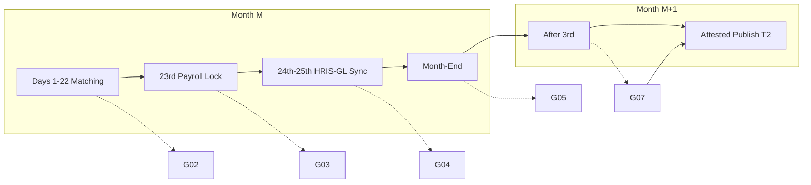

# [CLIENT] 23rd → 3rd+ Continuous Close Calendar & Dependency Gate Blueprint — `OP-FIN-009`

> **Purpose:** Deliverable #1 from the [one-pager](One_Pager_OP-FIN-009_Continuous_Close.md). Clone this template in Week 1–2 after the [diagnostic](Continuous-Close-Diagnostic-Questionnaire.md).

## A. Anchor dates (month *M*, close publishes after 3rd of *M+1*)

| Anchor | Typical calendar day | Definition |
| --- | --- | --- |
| **Payroll lock** | 23rd of *M* | HRIS payroll register frozen; mobility/fuel/Concur cutoff for payroll cycle |
| **Month-end** | Last day of *M* | Sub-ledgers stop accrual timing clock for non-payroll cutoffs |
| **Publication target** | Business days 1–3 of *M+1* after the 3rd | Attested company-wide financials / board pack |

**Pilot KPI:** ≤2–3 business days after the 3rd to attested publish (`HYP-2027-008`).

## B. Phase windows (exception-based loop)

| Window | Phase | Cadence | Exit criteria |
| --- | --- | --- | --- |
| Days 1–22 of *M* | Transaction matching | Daily | Unmatched items have Reason Code + owner |
| 23rd – month-end *M* | Payroll close & pre-validated JEs | Event + 24th–25th sync | Payroll clearing €0.00; accruals Preparer→Reviewer→Approver |
| Days 1–3+ of *M+1* | Exception-only variance & close | Daily exception queue | All gates green; T2 KPIs published |

## C. Dependency gates (hard blocks)

| Gate ID | Name | Blocks downstream until… | Owner |
| --- | --- | --- | --- |
| **G-01** | Bank / cash certified | KPI-01 auto-certify or exceptions cleared | Treasury |
| **G-02** | AP / AR sub-ledgers matched | Days 1–22 exceptions within SLA | AP/AR leads |
| **G-03** | 23rd payroll locked | HRIS register signed | Payroll |
| **G-04** | HRIS-to-GL sync (24th–25th) | Master data reconcile | Finance systems |
| **G-05** | Accrual batch approved | SoD-02 complete | Controller |
| **G-06** | IC / FX pre-checks | Diagnostic 3.4 | Consolidation lead |
| **G-07** | Consolidation & publish | All G-01–G-06 green | Corporate Controller |

## D. Reason Code starter set (unmatched items)

| Code | Meaning | Default SLA (business days) |
| --- | --- | ---: |
| **RC-TIMING** | Expected; clears on settlement | 3 |
| **RC-MASTER** | HRIS/ERP master data mismatch | 2 |
| **RC-DOCS** | Missing invoice / receipt | 5 |
| **RC-FX** | FX rate pending | 2 |
| **RC-IC** | Intercompany unmatched | 3 |
| **RC-INVESTIGATE** | True exception — Controller queue | 1 |

## E. Client tailoring worksheet (Week 1 workshop)

| Field | Client value |
| --- | --- |
| Payroll lock day (if not 23rd) | |
| Current post-3rd close duration (months) | |
| ERP / HRIS / BI stack | |
| Named gate owners G-01–G-07 | |

**Director archive — RGP close calendar templates (anonymized, 2007–2008)**

**Example 1 — Client A (EU services mid-market, 4 entities)**

| M window | Milestone | Gate | Notes |
| --- | --- | --- | --- |
| Days 1–22 | Daily AP/AR/bank match + Reason Codes | G-01, G-02 | Flash T0 allowed; no board metrics |
| 23rd | Payroll lock (salaried NL/BE/DE) | G-03 | HRIS sign-off on register; mobility cutoff for payroll cycle |
| 24th–25th | HRIS-to-GL cost-center / FTE sync | G-04 | Unmatched lines default `RC-MASTER` |
| Last day M | Month-end accrual batch (mobility, Concur backlog) | G-05 | Workflow `JE_CLOSE_ACCRUAL_*` Preparer→Reviewer→Approver |
| Days 1–3 M+1 | Exception queue + IC/FX pre-check | G-06 | **IC Due To/From** €0 per pair before consolidate |
| After 3rd M+1 | Attested publish | G-07 | T2 KPIs only; target **5 business days → 2–3** in pilot |

**Example 2 — Client B (US multi-entity services, 6 states)**

| M window | Milestone | Gate | Notes |
| --- | --- | --- | --- |
| Days 1–22 | Transaction matching (incl. Concur card feed) | G-02 | `RC-TIMING` on expected settlements |
| 23rd | Salaried payroll lock | G-03 | **2110 Payroll Clearing** must tie to register |
| Bi-weekly Fri | Hourly / field payroll (if in 3rd window) | G-03 alt | Separate clearing sub-account, same €0 rule |
| 24th–25th | Payroll-to-GL + benefits delta | G-04, G-05 | **3%** payroll variance review (client policy); **5%** elsewhere |
| Last day M | Fleet/fuel accrual through **6250** | G-05 | Not mixed into payroll clearing |
| BD 1–3 M+1 | Exception-only close | G-07 | Controller queue for `RC-INVESTIGATE` only |

**Workshop defaults carried from RGP templates:** payroll lock **23rd** unless statutory exception documented; publication anchor **business days 1–3 after the 3rd**; hard block consolidate until G-01–G-06 green.