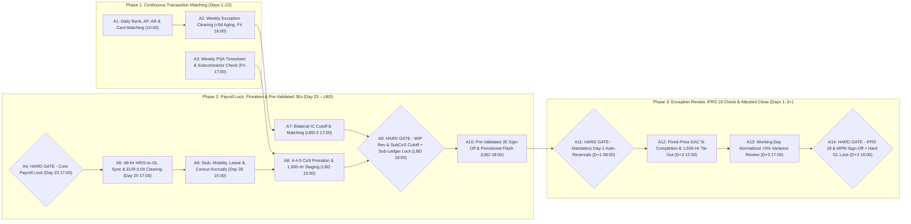

# Continuous Close Monthly Gantt Chart & Critical-Path Operating Schedule

**Architecture:** `Days 1–22` Continuous Matching → `Day 23` Core Payroll Lock → `4-4-5` / Month-End Cutoff (`LBD`) → `Day+1 to Day+3` Attested IFRS 18 GL Lock  
**Control Framework:** `FIN-CC-01` through `FIN-CC-10` | **Prepared by:** CBa Consult  
**Visual & Reference Editions:** [Continuous_Close_Monthly_Gantt_Chart.html](Continuous_Close_Monthly_Gantt_Chart.html) · [Continuous_Close_Monthly_Gantt_Chart.pdf](Continuous_Close_Monthly_Gantt_Chart.pdf) · [Continuous_Close_Enhanced_Activity_Guide.md](Continuous_Close_Enhanced_Activity_Guide.md)

---

## 1. Monthly Critical-Path Dependency Flow

---

## 2. Monthly Close Activity Schedule (`A1`–`A14`) & Hard Deadlines

| ID | Phase | Activity & Control Deliverable | Control ID | SoD Owner / Reviewer | Hard Deadline | Gantt Window | Gate |
| :--- | :--- | :--- | :--- | :--- | :--- | :--- | :--- |
| **A1** | Phase 1 | Daily bank, AP, AR & corporate-card auto-matching | `FIN-CC-01` | GL Accountant | Daily 10:00 (Days 1–22) | `D1–7` → `D15–22` | Bar |
| **A2** | Phase 1 | Weekly exception clearing & standardized reason codes (`<5d` aging) | `FIN-CC-01` | GL Accountant / Reviewer | Fri 16:00 (Days 5, 12, 19) | `D1–7` → `D15–22` | Bar |
| **A3** | Phase 1 | Weekly PSA / timesheet & subcontractor hours verification | `FIN-CC-09` | Project Accounting | Fri 17:00 (Days 7, 14, 21) | `D1–7` → `D15–22` | Bar |
| **A4** | Phase 2 | **Core Payroll Lock** (freeze base pay, overtime & statutory deductions) | `FIN-CC-04` | Payroll Operations | **Day 23 · 17:00** | `D23` | **Hard Gate** |
| **A5** | Phase 2 | 48-Hr HRIS-to-GL sync & `€0.00` payroll clearing tie-out | `FIN-CC-04` / IFRS 18 ¶83 | Payroll Spec. → GL Controller | **Day 25 · 17:00** | `D24–25` | Bar |
| **A6** | Phase 2 | Day 23–Month-End payroll stub, mobility, lease & Concur delta accruals (tagged Function & Nature) | `FIN-CC-01` | Senior Accountant | **Day 28 · 15:00** | `D26–28` | Bar |
| **A7** | Phase 2 | Intercompany (IC) billing cutoff & bilateral matching (`€0.00` IC delta) | `FIN-CC-05` | IC Accountant | **LBD-2 · 17:00** | `LBD-2` | Bar |
| **A8** | Phase 2 | `4-4-5` working-day CoS proration (`20/20/25`), PTO liability drawdown & `1,500`-hr absorption staging | `FIN-CC-08` / `FIN-CC-10` | Cost / FP&A Accountant | **LBD · 15:00** | `LBD-1` → `LBD` | Bar |
| **A9** | Phase 2 | **Simultaneous Unbilled WIP Revenue & Unvouchered Subcontractor CoS Cutoff + Sub-Ledger Lock** | `FIN-CC-09` / `FIN-CC-05` | Revenue / Project Acct. | **LBD · 18:00** | `LBD` | **Hard Gate** |
| **A10** | Phase 2 | Pre-validated recurring JE approval & `Provisional` flash dashboard watermark check | `FIN-CC-06` / IFRS 18 ¶117 | Corporate Controller | **LBD · 18:00** | `LBD` | Bar |
| **A11** | Phase 3 | **Mandatory Day-1 Auto-Reversals Fire** (automated ERP batch prior to post-close accruals) | `FIN-CC-02` | ERP Batch / Acct. Mgr. | **Day+1 · 08:00** | `D+1` | **Hard Gate** |
| **A12** | Phase 3 | Fixed-Price `% of Completion` (`EAC`) run & `1,500`-hr absorption `€0.00` GL tie-out | `FIN-CC-09` / `FIN-CC-10` | Cost/Rev Acct. → Controller | **Day+2 · 12:00** | `D+1` → `D+2` | Bar |
| **A13** | Phase 3 | Working-day normalized `>5%` MRC variance review & auto-certification of in-tolerance accounts | `FIN-CC-03` | GL Acct. → Controller / FP&A | **Day+2 · 17:00** | `D+2` | Bar |
| **A14** | Phase 3 | **IFRS 18 Subtotal / ¶117 MPM Sign-Off, Hard GL Lock & Attested Reporting Release** | `FIN-CC-05` / `FIN-CC-06` | Controller (GL) & CFO (MPM) | **Day+3 · 16:00** | `D+3+` | **Hard Gate** |

---

## 3. Dual-Calendar & Year-End Overlay (`FIN-CC-07`)

Because statutory reporting runs on a **01 Jan – 31 Dec** fiscal year while internal operating budgets run **01 Jul – 30 Jun** on a **4-4-5** calendar (13 weeks/quarter; 20/20/25 working days), two annual overlay gates are embedded without breaking the 3-day monthly cadence:

1. **30 June — Budget Year-End Gate (`01 Jul – 30 Jun`):**
   - Isolate annual bonus, sales commission, and vendor rebate true-up journals in a dedicated closing bucket with mandatory Day-1 auto-reversals (`FIN-CC-02`) to prevent distortion of July (`P1`) gross margin and `1,500`-hour Cost of Sales absorption rates.
2. **31 December — Statutory Fiscal Year-End Gate (`01 Jan – 31 Dec`):**
   - Execute a `1–5` day stub bridge from the final Friday `4-4-5` period close to `31-12` midnight cutoff (`FIN-CC-07`).
   - Reconcile **H2 Prior Budget (`Jan–Jun`) + H1 Current Budget (`Jul–Dec`) = Statutory FY (`Jan–Dec`)** to **`€0.00`**, accompanied by the IFRS 18 Operating Profit / MPM (`¶117`) and Nature-of-Expense (`¶83`) audit schedule.
