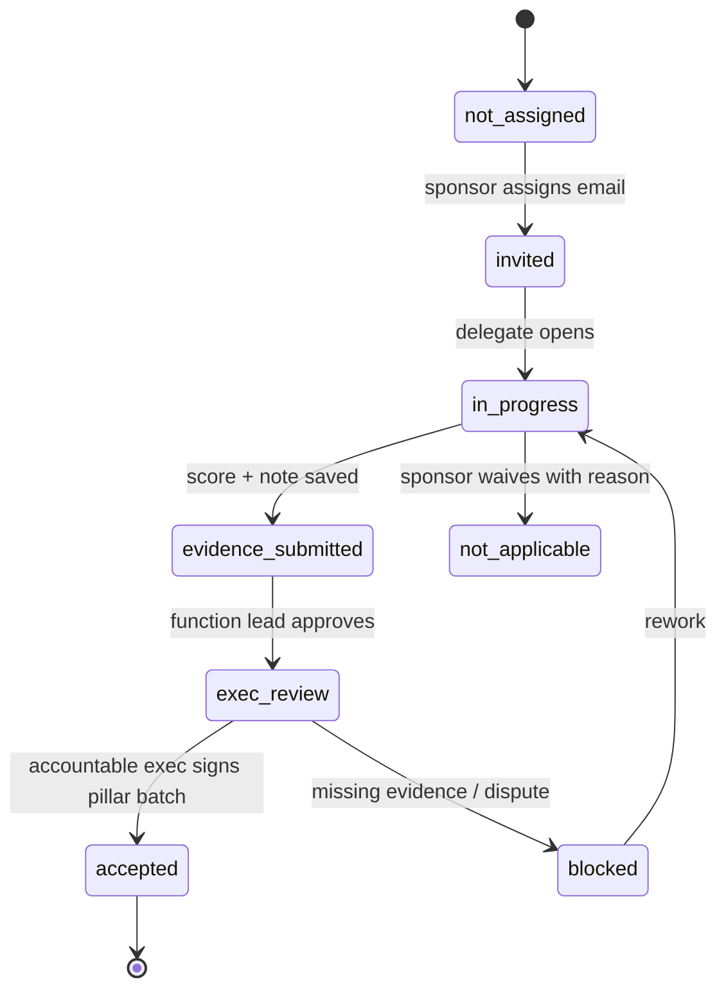

# Portal delegation & status dashboard — `OP-ITG-013`

**Purpose:** Product requirements for the **client-facing** assessment workspace (`mdresch/agent-governance-onboarding` or successor). Executives sponsor; professionals answer **only their routed questions**; everyone sees maturity progress on one dashboard.

**Data contract:** [data/agent-governance-question-ownership.json](data/agent-governance-question-ownership.json)  
**Human routing guide:** [Assessment-Delegation-and-Ownership-Matrix.md](Assessment-Delegation-and-Ownership-Matrix.md)

---

## 1. Personas & permissions

| Persona | Can do | Cannot do |
| --- | --- | --- |
| **Organization sponsor** | Create assessment, invite executives, assign function leads, reassign questions, approve release to CBa, view all scores | Change CBa methodology weights |
| **Executive (CEO/CFO/CIO/CISO/CAIO)** | View pillar rollup for their lane, approve delegate answers, request rework | Edit questions outside their accountability (optional: allow co-sign) |
| **Function lead** | View all questions for their function code, bulk-invite contributors | See other functions’ draft answers (configurable: **open** vs **siloed** mode) |
| **Contributor (specialist)** | Edit assigned questions, attach evidence metadata, set status | View org-wide dashboard (only “my queue”) |
| **CBa assessor (read-only)** | View released package, export JSON/PDF, comment internally | Edit client scores after release lock |

---

## 2. Assessment modes

| Mode | Questions loaded | Typical use |
| --- | --- | --- |
| **P0 triage only** | 10 P0 flags | LinkedIn / first touch (&lt;15 min sponsor + delegates async) |
| **Tier 1 portfolio** | P0 + Tier 1 full (20) + screen (6) per [Tier-1-vs-Tier-2-Cut-Sheet.md](Tier-1-vs-Tier-2-Cut-Sheet.md) | Paid triage / pre-briefing |
| **Tier 2 full** | All 40 + inventory register | Paid assessment |

On create, sponsor picks mode; portal pre-computes `question_ids[]` and default routes from JSON.

---

## 3. Delegation workflow (state machine)



**Statuses** (store per question): `not_assigned` · `invited` · `in_progress` · `evidence_submitted` · `exec_review` · `accepted` · `blocked` · `not_applicable`

---

## 4. Executive dashboard (sponsor view)

### 4.1 Header KPIs

| KPI | Calculation |
| --- | --- |
| **Overall completion** | `accepted` ÷ active questions (excludes `not_applicable`) |
| **P0 exposure** | Count of P0 marked “Yes / Present” |
| **Weighted maturity (draft)** | Average score where `accepted`, using pillar weights from questionnaire §1 |
| **Blocked** | Count `blocked` + unassigned &gt; 7 days |

### 4.2 Views (tabs)

1. **By executive lane** — columns: CIO, CISO, CFO, CEO, CAIO — % complete + overdue delegates.  
2. **By function** — ITG, SEC, IAM, … — burndown for workshop planning.  
3. **By pillar** — 8 pillars — RAG heatmap (red &lt;2.5 avg, amber 2.5–3.2, green ≥3.3).  
4. **P0 register** — sortable table with executive + delegate + remediation owner (client).

### 4.3 One-click actions

- **Invite function pack** — sends 6 pre-configured roles for Tier 1 (see matrix §3).  
- **Nudge overdue** — email delegates with deep link to question filter `?assignee=me&status=invited,in_progress`.  
- **Release to CBa** — locks scores, generates export (§6); requires ≥80% `accepted` or sponsor override with reason.

---

## 5. Contributor experience (“my queue”)

| Element | Requirement |
| --- | --- |
| **Landing** | “You have **n** questions (~**m** min)” — no pillar jargon in headline |
| **Question card** | Plain-language restatement + link to full diagnostic text + **evidence hint** from questionnaire |
| **Score control** | 1–5 rubric tooltips (collapsible) + **“I don’t know”** → forces `blocked` with comment |
| **Evidence field** | Free text + optional file upload (metadata only in Phase 1; no binary storage in git repo) |
| **Routing hint** | “Your function: IAM · Executive sign-off: CISO” |
| **Dependencies** | If Q4.2 blocked, notify FIN lead; optional soft-deps in JSON later |

**Mobile:** score + short note must work on phone (delegates often field workers, not executives).

---

## 6. Export schema (handoff to CBa briefing)

On **release**, emit `assessment-export.json`:

```json
{
  "organization": "string",
  "mode": "tier1_portfolio | tier2_full | p0_only",
  "released_at": "ISO-8601",
  "sponsor": { "name": "", "email": "", "role": "" },
  "completion_rate": 0.0,
  "p0_summary": [{ "id": "P0-01", "present": true, "owner": "", "comment": "" }],
  "responses": [
    {
      "question_id": "3.1",
      "score": 2,
      "status": "accepted",
      "accountable_exec": "CISO",
      "owner_function": "IAM",
      "assignee_email": "",
      "evidence_note": "",
      "updated_at": ""
    }
  ],
  "pillar_rollups": [{ "pillar": 3, "weighted_avg": 2.4, "accepted_count": 5 }]
}
```

Mirror sections in printable **Markdown/PDF** for [Executive-Readout-Template.md](Executive-Readout-Template.md).

---

## 7. Implementation notes (portal repo)

| Priority | Feature |
| --- | --- |
| P0 | Load `agent-governance-question-ownership.json`; map `questions[].id` to UI copy from questionnaire |
| P0 | Sponsor invite + magic link per contributor (no shared passwords) |
| P0 | Dashboard completion by function + executive lane |
| P1 | Executive batch approve (“accept all IAM questions”) |
| P1 | Tier mode switch + P0-first navigation |
| P2 | OAuth (Entra) tenant login for enterprise clients |
| P2 | Webhook on `release` → booking + CRM (per [Portal-Deploy-Checklist.md](Portal-Deploy-Checklist.md)) |

**Privacy:** Store PII in client-controlled backend only; portfolio git holds **spec + JSON routing**, never live client emails in commits.

---

## 8. Acceptance criteria (MVP for delegated assessment)

- [ ] Sponsor assigns ≥1 function lead; leads receive only their function’s question IDs.  
- [ ] Contributor completes one question with score + note; executive sees it in **exec_review**.  
- [ ] Dashboard shows &lt;100% until executive accepts pillar batch.  
- [ ] Export JSON validates against example in §6.  
- [ ] Tier 1 mode loads 26 question areas + 10 P0 (per cut sheet), not all 40.