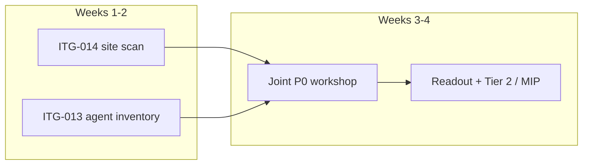

# Combined Phase 0 wedge — `OP-ITG-013` + `OP-ITG-014`

**Name (commercial):** **IT Technical & Information Quality Baseline**  
**Audience:** One executive sponsor (CIO or joint CIO/CISO/CDO)  
**Referenced in:** [Tier_A_Executive_Summary_2027.md](../../Tier_A_Executive_Summary_2027.md) §3

---

## Why bundle

| Layer | Opportunity | Question answered |
| --- | --- | --- |
| **Agents** | `OP-ITG-013` | Which agents exist, who owns them, what can they access? |
| **Context** | `OP-ITG-014` | Which documents are authoritative, safe, and current in the index? |

Agents without context governance retrieve poisoned answers; context without agent governance leaves autonomous actors unaccountable.

---

## Package outline

| Tier | ITG-013 | ITG-014 | Combined price anchor | Duration |
| --- | --- | --- | --- | --- |
| **Phase 0 A** | Tier 1 Triage | Tier 1 Baseline | **€4,500–€8,500** (bundle discount vs. separate) | 4–5 weeks parallel |
| **Phase 0 B** | Tier 2 Assessment | Tier 2 Full | **€10,000–€24,000+** | 8–12 weeks (staggered waves) |

*Explicit:* Two statements of work with shared readout optional; one steering committee.

---

## Single readout option (recommended)

**60–75 min joint executive readout:**

1. Agent P0 register (top 5)  
2. Context P0 register (top 5)  
3. Overlap: agents reading overshared libraries  
4. 90-day joint remediation + MIP (`OP-ITG-018`)

---

## Delivery sequencing

---

## GTM

- Same account in [GTM-Prospect-Tracker.md](../OP-ITG-013_Enterprise_AI_Agent_Governance/GTM-Prospect-Tracker.md) and [GTM-Prospect-Tracker.md](GTM-Prospect-Tracker.md) — mark **Bundle=Y** in CRM.  
- Cross-hypothesis: `HYP-2027-003` (Phase 0 wedge packaging across Tier A).

---

## Procurement

SKUs (interim until PRMAP): `CBA-ITG-013-T1` + `CBA-ITG-014-T1` on one buying file — see [Procurement-Pilot-Example-OP-ITG-013.md](../OP-SCM-003_Procurement_Readiness_Assessment_Portal/Procurement-Pilot-Example-OP-ITG-013.md) pattern for ITG-013; mirror export for ITG-014 when portal exists.