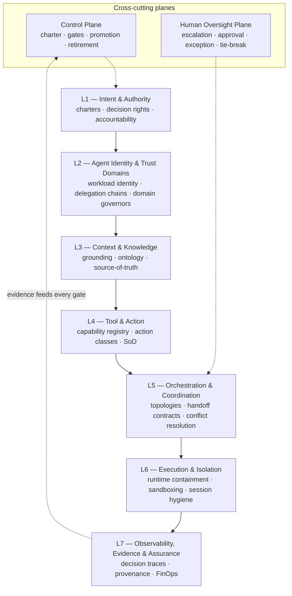

# Ideation Document — `OP-ITG-016`: Enterprise Agent Operating Architecture ("COBIT for Agents")

**Stage:** Tier 2 (Ideation) — architecture designed to working-draft depth; market evidence and pilot partner still open
**Tier:** A — Flagship · **Target Quarter:** Q3 2027 *(per [inventory](../../inventory-of-ideas.md) §6 and [Tier A summary](../../Tier_A_Executive_Summary_2027.md) §3 — both authoritative; this file does not override them)*
**Strategic Asset:** 3. Digital Labor · **Functional Area:** Pillar 17 — Intelligence & Autonomous Systems Governance · **Signature Toolkit:** Operating Model & Organization Design
**Owner:** Director (Menno Drescher, CBa Consult) · **Duration:** 8–12 weeks at 10–15 hrs/wk · **Capital anchor:** €5,000–€15,000+ (sweat equity, €0 cash)
**Precursor:** [`OP-ITG-013`](../OP-ITG-013_Enterprise_AI_Agent_Governance/Ideation-Spark.md) — this opportunity does not produce a Pilot #1 before `OP-ITG-013` has at least one completed engagement.

---

## 0. What this document is — and what it is not yet

**Is:** a Stage 1b Ideation Document. It designs the architecture itself at working-draft depth: layer model, control-domain map, identity-domain design, orchestration patterns, escalation model, lifecycle gates, assurance chain, maturity model, and what a "reference implementation" concretely means. It is deliberately reusable as the internal IP seed — it can be written and stress-tested before any client exists.

**Is not yet:** a client-facing one-pager, a Pilot Charter, or a Track B software spec. Per [Tailored-Hybrid-SIDPA-Governance.md](../../docs/governance/Tailored-Hybrid-SIDPA-Governance.md) §3, ADRs/BRD/FDD/User Stories and the 9 PMBOK subsidiary plans belong in a graduated `sidpa-template` repo after the Tier 3 gate (Track B, `G4-B`) — not in this folder. Status in the inventory stays `Idea`.

**Non-duplication:** all status, effort, capital, quarter and priority figures are cited from [inventory-of-ideas.md](../../inventory-of-ideas.md) and [Tier_A_Executive_Summary_2027.md](../../Tier_A_Executive_Summary_2027.md). External standards are named with a verification status in Appendix B; nothing here is presented as client-validated.

---

## 1. The problem this architecture answers

`OP-ITG-013` answers the **per-agent** question: *should this agent exist, who owns it, what may it touch, and is it logged and affordable?* It produces an inventory, an identity/permission blueprint, an observability and FinOps framework, and a remediation roadmap.

That is governance of **agents as assets**. It does not answer the **estate** question:

> When 300–500 agents, built by twelve business units on four platforms over three years, are running concurrently — which ones may talk to which, under whose authority, in what order, with what contract, and what happens when two of them disagree or one of them goes wrong at speed?

Today that question is answered by accident: agent-to-agent calls inherit whatever the calling agent's service principal happens to hold; a "supervisor" agent is really a prompt with a tool allowance; escalation is "alert a human in Teams and hope"; and retired agents keep working credentials because nobody owns the off-switch. Three failure modes follow, and they are the wedges this architecture sells against:

| Failure mode | What it looks like in practice | Business consequence |
| --- | --- | --- |
| **Authority sprawl** | Agent B is invoked by Agent A and silently inherits A's write scope on the ERP. No one can enumerate the effective permission of the chain. | Unbounded blast radius; SoD broken without a single control violation being logged |
| **Orchestration by coincidence** | Multi-step work is glued in prompts; retries, ordering and partial failure are undefined. | Silent double-actions (double payment, duplicate order), non-reproducible outcomes |
| **Accountability evaporation** | An agent takes a wrong action at 02:00; the trace shows a prompt and a tool call, not a decision, an authority or a named human. | Nobody can sign an incident report; regulator or auditor finds no decision provenance |

Gartner's 2027 signals already in [market-analysis-2027.md §17](../../market-analysis-2027.md) — agent abuse traced in enterprise breaches, most new apps "disposable," and a large share of agentic projects at cancellation risk on cost and control — are the demand-side argument. **These are inventory-sourced claims and must be re-verified against primary sources at the Tier 2 evidence gate (Appendix B).** The architecture does not depend on the exact percentages: it depends on the structural fact that agent estates grow faster than the control designs around them.

---

## 2. The architecture: seven layers and two planes

EAOA is deliberately layered so that each layer has **one owner type**, **one class of control**, and **one class of evidence**. Layers are not products; a layer may be served by a Microsoft capability, an open protocol, an internal build, or a manual control. The architecture's job is to make the boundary contracts explicit so any of those can be swapped without redesigning the estate.



| Layer | Core question it settles | Primary owner | Control class | Evidence produced |
| --- | --- | --- | --- | --- |
| **L1 Intent & Authority** | Why does this agent exist, and who is accountable for its actions? | Business process owner + accountable executive | Charter, decision-rights matrix, delegation-of-authority rules | Signed charter, authority register entry |
| **L2 Identity & Trust Domains** | As whom does this agent act, on whose behalf, with what delegation? | IAM / CISO | Identity domain policy, credential brokering, token scope | Identity inventory, delegation chain record |
| **L3 Context & Knowledge** | What may it know, from which authoritative source, at what freshness? | CDO / knowledge owner (via `OP-ITG-014`) | Source-of-truth rules, ontology, retrieval scoping | Context lineage record per answer |
| **L4 Tool & Action** | What may it *do*, and where is SoD enforced? | Platform / application owners | Capability registry, action classification, least privilege | Tool-call log with action class |
| **L5 Orchestration & Coordination** | How do agents cooperate, in what order, under what contract? | Enterprise Architecture | Handoff contract, topology pattern, quorum/tie-break rules | Run graph (who asked whom what) |
| **L6 Execution & Isolation** | Where does it run, and how is a bad run contained? | Platform / infrastructure (via `OP-ITG-017`) | Sandbox, golden image, scale-to-zero, session reset | Runtime attestation, containment event |
| **L7 Observability & Assurance** | Can we reconstruct and prove what happened, and what it cost? | CISO / Internal Audit / FinOps | Trace schema, evidence chain, budget envelopes | Decision provenance, cost-per-outcome |

The two planes exist because two classes of control cannot live inside a layer:

- **Control Plane** owns **time** — the lifecycle. It is the only component allowed to change an agent's authority, promote it, or kill it.
- **Human Oversight Plane** owns **interruption** — the authority to stop, override or accept risk. It is deliberately separate from the control plane so that an automation failure cannot remove the human route out.

---

## 3. Control domains: the COBIT mapping

"COBIT for Agents" is not a new framework invented from nothing, it is **COBIT 2019's governance and management objectives re-scoped from IT processes to agent behaviour**. COBIT already separates *governance* (EDM — evaluate, direct, monitor) from *management* (APO, BAI, DSS, MEA). Agent estates fail in exactly the seam COBIT was designed around: nobody evaluates whether the estate should look like this, while everybody manages individual agents.

Draft control-domain map — **30 objectives in six domains**, each with one primary evidence artifact. This is the core reusable IP of the offer; the client-facing version of this table is the assessment instrument.

### 3.1 EDM-A — Agent Governance (5 objectives)

| # | Objective | Question | Evidence |
| --- | --- | --- | --- |
| EDM-A-01 | Agent estate governance framework | Is there one accountable forum for the agent estate, with defined decision rights? | Charter + meeting/decision log |
| EDM-A-02 | Benefit & risk steering | Are agents steered by realised benefit vs. risk appetite, not by pilot enthusiasm? | Portfolio value review |
| EDM-A-03 | Risk appetite for autonomy | Is there an explicit, per-action-class appetite for how much autonomy is granted? | Autonomy tier policy |
| EDM-A-04 | Resource optimisation | Is agent spend optimised as a portfolio (reuse before build, retire before renew)? | FinOps envelope report (L7) |
| EDM-A-05 | Stakeholder transparency | Can the board/audit committee see the agent estate, its incidents and its cost? | Estate dashboard + incident summary |

### 3.2 APO-A — Agent Strategy & Portfolio (6 objectives)

| # | Objective | Question | Evidence |
| --- | --- | --- | --- |
| APO-A-01 | Estate architecture standard | Is there one target architecture that new agents must conform to? | This document, adopted as standard |
| APO-A-02 | Agent portfolio management | Is there a register of every agent with owner, criticality, tier and lifespan? | Agent register (= `OP-ITG-013` inventory, extended) |
| APO-A-03 | Innovation & disposable-agent intake | Is there a bounded, fast path for short-lived agents without bypassing control? | Disposable class policy (see §7.4) |
| APO-A-04 | Reuse & consolidation | Are overlapping agents consolidated before new ones are built? | Duplication analysis |
| APO-A-05 | Agent risk management | Are agent risks in the enterprise risk register with owners and tolerances? | Risk register extract |
| APO-A-06 | Vendor & standard alignment | Is the estate's dependence on MCP/A2A/vendor control planes documented and tolerance-tested? | Standards dependency register |

### 3.3 BAI-A — Agent Build & Change (6 objectives)

| # | Objective | Question | Evidence |
| --- | --- | --- | --- |
| BAI-A-01 | Charter before build | Does every agent start from a charter with a named accountable human? | Charter artefact (L1) |
| BAI-A-02 | Capability-first design | Are tools and capabilities requested by action class rather than by connector? | Capability request record (L4) |
| BAI-A-03 | Sandbox-only development | Can no agent reach production data before certification? | Sandbox attestation (L6) |
| BAI-A-04 | Handoff contract definition | Does every multi-agent collaboration define a typed contract, not prompt glue? | Handoff contract (L5) |
| BAI-A-05 | Certification & acceptance | Is there a standard test suite proving identity scope, SoD, escalation and rollback? | Certification report (see §9.2) |
| BAI-A-06 | Change control for behaviour | Are prompt, model, tool and policy changes versioned and reversible like code? | Version history + rollback proof |

### 3.4 DSS-A — Agent Operations (5 objectives)

| # | Objective | Question | Evidence |
| --- | --- | --- | --- |
| DSS-A-01 | Run-time operations | Is there an owner for agent operations with defined SLAs for agent failure? | Ops runbook |
| DSS-A-02 | Containment & kill switch | Can any agent or run graph be stopped within a stated time, by a named role? | Containment test log (§9.2) |
| DSS-A-03 | Incident handling | Does incident triage distinguish agent-caused from human-caused events? | Incident records, triage rule |
| DSS-A-04 | Continuity & degradation | Is there a defined human-only fallback when the agent estate is unavailable or distrusted? | Fallback procedure |
| DSS-A-05 | Security of agent surface | Are agent endpoints, tool servers and MCP servers in scope of security monitoring? | Security control coverage map |

### 3.5 MEA-A — Agent Monitoring, Assurance & Compliance (5 objectives)

| # | Objective | Question | Evidence |
| --- | --- | --- | --- |
| MEA-A-01 | Performance & outcome measurement | Is success measured per agent in business terms (cycle time, cost per outcome, error rate)? | KPI pack |
| MEA-A-02 | Control effectiveness testing | Are agent controls tested on a cadence, not assumed? | Control test register |
| MEA-A-03 | Evidence & decision provenance | Can every consequential action be reconstructed with authority, context and approver? | Provenance chain (L7) |
| MEA-A-04 | Compliance mapping | Is the estate mapped to ISO/IEC 42001, NIST AI RMF and EU AI Act obligations where applicable? | Control-compliance matrix (links `OP-RSK-004`) |
| MEA-A-05 | Independent assurance | Is there a route to independent review of the estate (internal audit, external assessment)? | Assurance plan |

### 3.6 ORG-A — Human–Agent Operating Model (3 objectives)

| # | Objective | Question | Evidence |
| --- | --- | --- | --- |
| ORG-A-01 | Role & supervision design | Is it defined which tasks are agent-owned, human-supervised or human-owned? | Task-ownership matrix (links `OP-HR-009`) |
| ORG-A-02 | Capability & literacy | Can the humans who supervise agents actually read agent evidence? | Capability plan |
| ORG-A-03 | Workforce transition | Is displacement/redesign handled deliberately and lawfully (works council / CLA where relevant)? | Transition plan |

> **Assessment form.** Each objective is scored against the 5-level maturity scale in §10, with evidence-or-assert. A level is only credited where an artefact exists; "the vendor says it does that" is scored as level 1. This rule is what separates the offer from a capability checklist.

---

## 4. Agent identity domains — the distinctive design

The single design decision that makes this architecture more than a repackaged COBIT deck: **the estate is partitioned into identity domains, not flatly into a single tenant-wide agent directory.**

An identity domain is a bounded trust region with: one **domain governor** (a named human or role), one **authority ceiling** (the maximum action class any agent in the domain may take), one **policy set**, and one **shared evidence boundary**.

| Domain archetype | Typical members | Authority ceiling | Governor |
| --- | --- | --- | --- |
| **D-FIN** Financial operations | close, reconciliation, AP/AR, rate-engine agents | Commit (bounded value), never master-data creation | Controller |
| **D-CX** Customer-facing | intake, triage, response, onboarding agents | Draft + send within template, never contract commitment | Head of CX |
| **D-KNW** Knowledge & research | RAG, summarisation, context curation agents | Read-only across labelled sources | CDO |
| **D-SEC** Security & compliance | monitoring, evidence, triage agents | Read + alert, never remediation without human gate | CISO |
| **D-HR** People operations | screening, scheduling, payroll-support agents | Draft + recommend, never decide (EU AI Act Annex III human oversight) | CHRO |
| **D-PLT** Platform & engineering | build, test, ops-assist agents | Non-production write, production read | Platform lead |

**Cross-domain interaction is the crux.** An agent in D-FIN may not be called by an agent in D-CX by ambient permission. Cross-domain invocation requires a **federation contract**: a declared, reviewable agreement naming caller domain, callee domain, allowed action class, maximum delegation depth, rate/volume ceiling, and the human authority that accepts the residual risk. Three rules make this enforceable:

1. **No transitive authority.** Authority does not flow through an agent. A call chain of depth *n* carries the *intersection* of every linking contract's authority, never the union. Effective authority is computed, logged and capped.
2. **Delegation has a named human origin.** Every delegation chain terminates in a human principal with a decision right. Machine-to-machine delegation without a human origin is a control finding, not a configuration.
3. **Depth and fan-out are bounded.** A stated maximum depth and fan-out per domain prevents a single prompt from spraying the estate.

This is where the architecture produces business value that a per-agent governance assessment cannot: it converts an unenumerable estate into a **small number of governable trust boundaries**, which is what lets an enterprise say "we can scale from 40 to 400 agents without re-architecting."

---

## 5. Orchestration and coordination patterns

The second reusable component: a **pattern catalogue with selection criteria**, so the enterprise stops inventing a topology per use case.

| Pattern | Structure | Use when | Primary risk | Required controls |
| --- | --- | --- | --- | --- |
| **Supervisor** | One orchestrator decomposes and delegates; workers cannot talk to each other | Task has clear decomposition and one accountable outcome | Orchestrator becomes a single over-privileged node | Orchestrator holds no tool rights — it holds routing rights only |
| **Peer handoff** | Agents pass a typed work item along a defined chain | Sequential process steps (intake → enrich → decide → notify) | Partial failure mid-chain loses state | Durable work-item state, idempotency keys, resumable checkpoints |
| **Council / quorum** | Parallel agents produce independent judgements; a resolver decides | High-stakes classification where error cost is high (risk, compliance, medical-adjacent) | Correlated error if agents share the same context source | Independence requirement on L3 sources; explicit disagreement escalation |
| **Market / bidding** | Agents publish capability, work is routed to best-fit | Large heterogeneous estate with overlapping skills | Unpredictable cost and latency | Published cost/latency per agent, envelope caps |
| **Sandboxed trial** | Candidate agent executes against a shadow environment before commit | Irreversible or high-value action | Shadow/production divergence | Golden-image parity check (`OP-ITG-017`), divergence tolerance |

**Handoff contract** — the artefact that makes any pattern auditable. Every agent-to-agent interaction is typed: *intent*, *input schema*, *expected output schema*, *preconditions*, *postconditions*, *effect class* (read / draft / commit / irreversible), *idempotency key*, *timeout*, *escalation target on failure*, *authority required*. Prompt-to-prompt calls without a contract are recorded as a control finding at BAI-A-04, which is the single most common and most expensive gap found in practice.

---

## 6. Escalation and human authority

Escalation in most estates is a notification. In EAOA it is a **typed decision with an owner, a deadline and a default**.

### 6.1 Escalation triggers

| Trigger | Basis | Default behaviour |
| --- | --- | --- |
| **Action class** | Effect class of the planned action (irreversible, financial above threshold, legal commitment, PII/HR decision) | Hard stop before execution |
| **Confidence / disagreement** | Agent self-assessment below threshold, or council members disagree | Route to resolver, then human |
| **Policy ambiguity** | No policy matches the situation, or two policies conflict | Stop; ambiguity is a control event, not a judgement call |
| **Anomaly / velocity** | Volume, cost or action rate outside envelope | Throttle, then escalate |
| **Novelty** | Situation outside the agent's charter scope | Refuse with reason; escalate |
| **Retail/consumer-facing** | Any customer-visible commitment | Human approval regardless of confidence |

### 6.2 Escalation ladder

```
L0 Agent self-check → L1 Supervisor agent (routing only, no authority)
   → L2 Human operator (queue, SLA, can approve within a stated ceiling)
   → L3 Process owner (can accept risk, change the policy)
   → L4 Accountable executive (can grant autonomy tier, accept residual risk in writing)
```

Every rung declares: **decision right**, **time ceiling**, **default on timeout** (fail-closed: the action does not happen; fail-open is a per-action-class decision that must be made by L4 in writing, never by an agent), and **evidence written**. Unresolved tie-breaks at L3 halt and escalate — the same `DecisionAuthority.FULL` halting pattern the [SIDPA governance model](../../docs/governance/Tailored-Hybrid-SIDPA-Governance.md) already applies to project gates, applied here to agent execution.

### 6.3 Autonomy tiers

A four-tier ladder, assigned per action class per domain, reviewed on a cadence — this is the artefact that makes "how much can we trust it" a governed decision instead of an opinion:

| Tier | Agent may | Human role |
| --- | --- | --- |
| **A0 Advise** | Recommend only | Decides and acts |
| **A1 Draft** | Prepare; human sends/commits | Reviews each instance |
| **A2 Act with gate** | Execute reversible actions; gate irreversible ones | Approves exceptions and gates |
| **A3 Act bounded** | Execute within envelope; report after | Samples, audits, can revoke |

Promotion between tiers is a control-plane decision with evidence (MEA-A-02 test results), never a configuration change — this is the single most-asked question in an agent board review.

---

## 7. Lifecycle gates

Seven gates, one owner each, one non-negotiable artefact each. The control plane is the only component permitted to move an agent between them.

| Gate | Name | Owner | Must exist to pass | Kills the agent if… |
| --- | --- | --- | --- | --- |
| **G1** | Propose | Business process owner | Problem statement, expected outcome KPI, build-vs-reuse check | Reuse candidate exists (APO-A-04) |
| **G2** | Charter | Accountable executive | Named human owner, domain, autonomy tier, action classes, budget envelope | No named human owner |
| **G3** | Build in sandbox | Platform lead | Capability set declared by class, no production data reachable | Requires ambient standing credentials |
| **G4** | Certify | CISO / EA | Identity scope proof, SoD proof, escalation test, rollback test, containment test | Any test fails; no exceptions |
| **G5** | Promote | Control plane (via domain governor) | Least-privilege scope narrow as possible, observability live, envelope set | Cannot be observed or stopped |
| **G6** | Operate & optimise | Ops owner | KPI pack live, control tests on cadence, cost per outcome tracked | Repeated control failure, or cost/benefit inverted |
| **G7** | Retire | Control plane | Credentials revoked, tools detached, knowledge and evidence archived, context returned to L3 | *(never killed — retirement is mandatory, not optional)* |

**G7 is the gate most estates have never designed.** A retired agent that keeps a live service principal is an unowned insider. Retirement also returns value: the traces become training and evaluation data, and the charter/handoff contracts become reusable patterns — the compounding reason this architecture suits a retainer (`OP-ITG-018`).

### 7.4 The disposable-agent class

Because a large share of new agents are short-lived (the "disposable app" signal in [market-analysis-2027.md §17](../../market-analysis-2027.md)), the architecture defines a **fast path that is not an exemption**: a disposable class with a fixed maximum lifespan (for example 90 days), a pre-approved capability template, no production write, automatic expiry and mandatory G7 on expiry. Speed comes from removing design review, not from removing containment.

---

## 8. Assurance: evidence chain and measurements

### 8.1 The decision provenance chain

For any consequential action the architecture requires a reconstructable chain — this is where `OP-RSK-005` (Evidence Assurance) plugs in:

```
intent (charter + autonomy tier)
  → authority (identity, delegation origin, effective scope)
  → context used (sources, versions, freshness — from L3)
  → plan / ordered steps (run graph, handoff contracts)
  → policy decision (which rule allowed it, or which ambiguity stopped it)
  → approval (named human, timestamp, decision)
  → effect (tool call, external result, idempotency key)
  → outcome (business KPI delta)
```

If any link is missing, the action is classed as *unattested* and counts against MEA-A-03. This is the concrete meaning of "auditable agent": not that logs exist, but that the chain is complete and machine-reconstructable.

### 8.2 Certification test suite (the reference-implementation core)

G4 requires passing a standard suite — six tests that any vendor-neutral architecture can demand:

1. **Scope proof** — agent cannot exceed declared action classes, demonstrated by attempted violation.
2. **SoD test** — the agent cannot complete a conflicting pair of actions (e.g. create vendor + post payment) even when instructed.
3. **Delegation test** — transitive authority does not exceed the intersection of contracts.
4. **Escalation test** — each trigger fires, lands on the right rung, and fails closed on timeout.
5. **Containment test** — a running agent/run graph is stopped within the stated time by a named role.
6. **Rollback/idempotency test** — a retried step does not double-apply the effect.

### 8.3 Non-functional targets (proposed, to be validated in pilot)

| Measure | Target | Why it matters |
| --- | --- | --- |
| Agents in register with named owner | 100% | No orphan agents |
| Agents holding standing human credentials | 0 | Eliminates authority sprawl class |
| Cross-domain calls covered by a federation contract | ≥95% | Bounded blast radius |
| Consequential actions with complete provenance chain | ≥95% | Auditability |
| Mean time to contain a runaway agent | ≤ stated SLA (single-digit minutes) | Limits damage |
| Autonomous actions outside declared class | 0 | The control that is actually sold |
| Cost per completed outcome, per agent | Tracked for 100% of A2/A3 agents | FinOps defensibility |

---

## 9. What "reference implementation" concretely means

The inventory promises "Architecture Blueprint → Reference Implementation." That second half is only credible if it is scoped now. The reference implementation is **six artefacts, provider-neutral, delivered as a working baseline rather than a demo**:

| # | Artefact | Contents | Reuses |
| --- | --- | --- | --- |
| **RI-1** | **Agent & domain register** | Machine-readable schema for agent, owner, domain, tier, action classes, lifespan, contract links | `OP-ITG-013` inventory structure |
| **RI-2** | **Policy-as-code pack** | Identity scoping, delegation ceilings, autonomy tiers, escalation rules expressed as versioned policy | Entra Agent ID / Agent 365 capabilities where present; provider-neutral fallback |
| **RI-3** | **Contract & conformance harness** | Typed handoff-contract schema + the six-test certification suite from §8.2 | MCP/A2A conformance where applicable |
| **RI-4** | **Provenance & trace schema** | The §8.1 chain as an open schema (OpenTelemetry-compatible agent spans, not a proprietary format) | `OP-RSK-005` ECS evidence thinking |
| **RI-5** | **Escalation & containment engine** | Reference implementation of ladder, timeouts, fail-closed defaults, kill switch | `sidpa-template` gate/tie-break pattern (`DecisionAuthority.FULL`) |
| **RI-6** | **Sandbox execution fabric** | Golden-image sandbox pool with session reset and scale-to-zero for trial and containment | `OP-ITG-017` MXC Hyper-V JIT sandboxes |

**Governance-as-code substrate.** RI-2 and RI-5 are built as a `sidpa-template` graduation (Track B): the same 18-stage closed-loop discipline that governs projects, applied to agent change — a design-time loop for architecture/policy changes and an execution-time loop for observed agent behaviour (mirroring the two-loop separation already mandated in [Tailored-Hybrid-SIDPA-Governance.md](../../docs/governance/Tailored-Hybrid-SIDPA-Governance.md) §5). That reuse is the reason this is a genuinely low-capital build: the governance engine already exists.

---

## 10. Maturity model

Five levels, scored per layer and per control domain, aggregated into an **Agent Operating Maturity Index (AOMI)**. Deliberately behavioural — each level is defined by what is *provable*, not what is intended.

| Level | Name | Test of the level |
| --- | --- | --- |
| **1** | Ad hoc | Agents exist; no register, no owners, authority inherited |
| **2** | Inventoried | Register and owners exist; per-agent controls in place (`OP-ITG-013` completed) |
| **3** | Bounded | Identity domains, action classes, escalation and containment defined and tested for the majority of the estate |
| **4** | Orchestrated | Handoff contracts standard, patterns selected by criteria, provenance complete, autonomy tiers governed |
| **5** | Adaptive | Estate self-optimises under control: portfolio steering, retirement by design, standards churn absorbed without redesign |

Use in the engagement: baseline score at week 1–2 (evidence-or-assert), target level agreed with the sponsor, gap-to-target becomes the roadmap. Level 3 is the realistic first-engagement outcome for most buyers; level 5 is a 2028–2030 destination, which is exactly why the offer compounds into a retainer.

---

## 11. Engagement shape

Two-stage, mirroring the pattern already used across the tier-A portfolio (assessment → architecture → implementation):

| Stage | Duration | Content | Price anchor |
| --- | --- | --- | --- |
| **Blueprint** | 8–12 weeks | Maturity baseline, domain design, control-domain tailoring, topology selection, escalation/lifecycle design, target-state roadmap | €5,000–€15,000+ *(per [inventory](../../inventory-of-ideas.md) §6)* |
| **Reference Implementation** | Follow-on, scoped | RI-1…RI-6, certification suite running, first domain live | Scoped after blueprint |

**Deliverables (blueprint):** (1) Agent estate maturity baseline & AOMI; (2) target architecture on one page (the §2 layer/plane model tailored); (3) identity-domain and federation-contract design; (4) orchestration pattern decisions per use case; (5) escalation & autonomy-tier model with the RACI; (6) lifecycle gate definitions with evidence checklist; (7) 90/180/365-day roadmap with sequenced gates.

**Buyer and sponsorship:** CIO / CTO / Enterprise Architect, with the accountable executive per domain as the real co-signer. This is not a mid-level IT purchase — it is an estate-level design. Entry route: a completed `OP-ITG-013` engagement (its remediation roadmap is literally this architecture's business case) with `OP-ITG-014` as the context-layer dependency and `OP-HR-009` for ORG-A.

---

## 12. Boundaries, risks and failure modes

**Explicitly out of scope (non-negotiable, protects both sides):**

- **Not an agent platform, model vendor or systems integrator.** No licensing of agent runtimes, no build-the-client's-agents commitment.
- **Not a security product or MSSP.** Containment architecture is designed; SOC operation is not delivered.
- **Not legal advice.** EU AI Act / GDPR / DORA classification is designed and evidenced, with client counsel owning the legal opinion (consistent with the portfolio's standing non-legal boundary).
- **Not a guarantee of autonomous correctness.** The architecture makes autonomy *bounded and observable*, not safe in an absolute sense; that distinction is written into the engagement terms.
- **No 500-agent premise assumed.** The design must work at 40 agents and remain correct at 400; selling the scale story to an estate of 12 agents is a credibility loss.

**Top risks:**

| Risk | Severity | Mitigation |
| --- | --- | --- |
| **Standards churn (MCP, A2A, vendor control planes)** | High | Layer contracts are typed and provider-neutral; RI-3 isolates conformance; APO-A-06 tracks dependencies; nothing in the design names a protocol as load-bearing |
| **Precursor dependency on `OP-ITG-013`** | High | No Pilot #1 before a completed `OP-ITG-013` engagement supplies a real agent inventory to design against |
| **Single-vendor gravity (Microsoft-centric estate)** | Medium | Design on capability boundaries; map to Entra Agent ID / Agent 365 as one *implementation* of L2/L7, never as the architecture |
| **Capacity cap 10–15 hrs/wk** | Medium | The blueprint is the deliverable; the reference implementation is follow-on and can be graduated to Track B rather than delivered in the same sprint |
| **Buyer immaturity (estate <50 agents)** | Medium | Qualify on estate size and prior `OP-ITG-013`; otherwise sell the smaller wedges |
| **Framework theatre** | High | Evidence-or-assert scoring (§3) and the six-test certification suite (§8.2) are the antidote; a maturity score without artefacts is not issued |
| **Scope creep into platform build** | High | Reference implementation is fixed at RI-1…RI-6; anything else is a separate engagement |

**#1 failure mode:** the deliverable becomes a beautiful control framework that the client cannot enforce, because the architecture was designed without the client's actual identity, policy and observability tooling in the room. Mitigation: every control domain is mapped to a *named mechanism in the client's estate* during the blueprint, and any objective with no mechanism is labelled "unimplementable today" on the roadmap rather than scored.

---

## 13. Proposed hypotheses (for Director registration)

Per [Tailored-Hybrid-SIDPA-Governance.md](../../docs/governance/Tailored-Hybrid-SIDPA-Governance.md) §3 Stage 2, these are drafted to the 5-part falsifiable contract and **are not yet in the register**. The next free `HYP-2027-NNN` IDs are to be allocated by the Director on registration (the register currently runs to `HYP-2027-012`); nothing here should be treated as registered.

1. **Desirability / Viability** — *We believe* CIOs/CTOs at enterprises that have completed an agent governance assessment (≥150 agents in inventory) *will* commission a fixed-scope operating-architecture blueprint at €5,000–€15,000+ *because* their governance roadmap names orchestration and identity-domain gaps they cannot close internally. *True if* ≥2 of 10 such conversations reach a scoped proposal within 8 weeks; *false if* buyers consistently treat orchestration as a platform-vendor problem.
2. **Feasibility / IP reuse** — *We believe* the COBIT-domain mapping, layer model and pattern catalogue in this document cover ≥70% of a first blueprint *without* client-specific R&D, in ≤40 hours of tailoring. *True if* a dry-run tailoring against one real `OP-ITG-013` inventory stays within 40 hours; *false if* each client requires a from-scratch framework.
3. **Scalability / Compounding** — *We believe* ≥50% of completed blueprints convert into either a reference-implementation follow-on or an `OP-ITG-018` MIP retainer within 90 days. *True if* ≥1 of the first 2 blueprints converts; *false if* blueprints end as advisory documents with no implementation path.

---

## 14. Open Tier 2 questions

- **Standards verification (blocking for §5/§9):** confirm the current governance and maturity status of MCP and A2A, and whether their conformance tooling can carry RI-3. Primary sources only.
- **Vendor control-plane verification:** verify which L2/L7 capabilities Entra Agent ID / Agent 365 actually provide today, licensed at what tier — the design must not assume an unlicensed capability.
- **Regulatory scoping:** confirm which of the 30 control objectives are legally mandatory (EU AI Act Annex III, DORA/NIS2 for financial clients) vs. good practice, so the assessment can be sold as compliance-bearing.
- **Comparable benchmarks:** two or three real market comparables for agent-architecture advisory pricing and packaging (G4 Big Four / integrator boundary), per gate `G1b`.
- **Estate-size threshold:** define the minimum agent estate at which this offer is sellable, so qualification is objective.
- **Certification suite practicality:** confirm the six tests in §8.2 are executable on at least two distinct platforms (one Microsoft-centric, one open-stack), or the "provider-neutral" claim is marketing.

---

## 15. Gate checklist (Stage 1b → Stage 2)

- [ ] Standards and vendor capabilities verified from primary sources (Appendix B items marked *unverified*).
- [ ] Two or three market comparables benchmarked; differentiation vs. Big Four / integrator / agent-platform vendor stated.
- [ ] Hypotheses H1–H3 registered by the Director with allocated IDs, status `Formulated`.
- [ ] One dry-run tailoring of this architecture against a real estate (internal or a completed `OP-ITG-013` client) to test hypothesis 2.
- [ ] Decision recorded: is a client-facing one-pager written now, or only after the first `OP-ITG-013` pilot (tracker currently says "no action until `OP-ITG-013` has a pilot")?
- [ ] Track selection recorded for the build: Track A (blueprint-only advisory) vs. Track B (`sidpa-template` graduation for RI-2/RI-5).

---

## Appendix A — Glossary of terms introduced here

| Term | Meaning |
| --- | --- |
| **EAOA** | Enterprise Agent Operating Architecture — this opportunity's architecture |
| **Identity domain** | Bounded trust region for agents with one governor, one authority ceiling, one policy set |
| **Federation contract** | Declared cross-domain agreement: caller, callee, action class, depth, volume, residual-risk owner |
| **Action class** | Read / draft / commit / irreversible — the unit of authority, not the connector |
| **Handoff contract** | Typed agent-to-agent interaction: schema, pre/postconditions, effect class, idempotency, escalation target |
| **Autonomy tier** | A0 advise → A3 act bounded; assigned per action class, promoted only on evidence |
| **Provenance chain** | The eight-link reconstructable record from intent to outcome (§8.1) |
| **AOMI** | Agent Operating Maturity Index — 1–5, evidence-or-assert |
| **Unattested action** | A consequential action without a complete provenance chain; counts against MEA-A-03 |

## Appendix B — Source provenance and verification status

| Claim | Source | Status |
| --- | --- | --- |
| Effort, capital, quarter, tier, priority | [inventory-of-ideas.md §6](../../inventory-of-ideas.md), [Tier A summary §3](../../Tier_A_Executive_Summary_2027.md) | **Authoritative** (cited, not restated as new fact) |
| Market signals: agent abuse in breaches, disposable apps, agentic-project cancellation, AI-security spend | [market-analysis-2027.md §17](../../market-analysis-2027.md) (cites Gartner) | **Inventory-sourced — re-verify against primary Gartner material at Tier 2** |
| COBIT 2019 structure (EDM/APO/BAI/DSS/MEA) as the mapping basis | Public framework | Verify edition and objective numbering against primary COBIT documentation before client use |
| MCP / A2A protocol status and conformance tooling | Public standards | **Unverified — blocking open question (§14)** |
| Entra Agent ID / Agent 365 capability and licensing | Microsoft | **Unverified — blocking open question (§14)** |
| ISO/IEC 42001, NIST AI RMF, EU AI Act Annex III applicability | Public standards / regulation | Verify current effective dates and scope with client counsel; not legal advice |
| `sidpa-template` gate, tie-break and two-loop patterns | Internal repo (cited in governance doc) | Exists; reuse claim to be confirmed during Track B graduation |
| Seed evidence for gate/tie-break patterns actually in use | `mdresch/sidpa-template` Stage 16 pipelines | Internal asset, as stated in [Ideation-Spark.md](Ideation-Spark.md) |
| 5-level maturity scale, domain archetypes, 30 objectives, gates, tests | **This document (original design)** | Draft IP — no client validation claimed |
