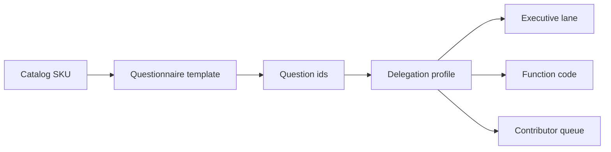

# Service catalog → questionnaire map — `OP-SCM-003`

**Principle:** Procurement selects a **SKU**; the portal resolves **questionnaire_template_id** and **delegation_profile_id** from this table. Extend as new `OP-*` diagnostics mature.

---

## Catalog schema (logical)

| Field | Description |
| --- | --- |
| `sku` | Stable id, e.g. `CBA-ITG-013-T1` |
| `opportunity_id` | Portfolio row, e.g. `OP-ITG-013` |
| `title` | Buyer-facing name |
| `tier` | `screen` · `triage` · `full` |
| `questionnaire_ref` | Path or repo id to JSON template |
| `delegation_ref` | Path to ownership / RACI JSON |
| `estimated_minutes` | Contributor effort hint |
| `price_band_eur` | From inventory (indicative) |
| `executive_lanes` | e.g. `CIO,CISO,CFO` |

---

## MVP mappings

| SKU | `opportunity_id` | Tier | Questions (approx.) | Questionnaire / delegation source |
| --- | --- | --- | ---: | --- |
| `CBA-ITG-013-T1` | `OP-ITG-013` | triage | 37 | [Tier-1-vs-Tier-2-Cut-Sheet.md](../OP-ITG-013_Enterprise_AI_Agent_Governance/Tier-1-vs-Tier-2-Cut-Sheet.md) + [data/agent-governance-question-ownership.json](../OP-ITG-013_Enterprise_AI_Agent_Governance/data/agent-governance-question-ownership.json) · **Interim portal:** [`agent-governance-onboarding`](https://github.com/mdresch/agent-governance-onboarding) · [Procurement-Pilot-Example-OP-ITG-013.md](Procurement-Pilot-Example-OP-ITG-013.md) |
| `CBA-ITG-013-T2` | `OP-ITG-013` | full | 40 + P0 | [Agent-Governance-Assessment-Questionnaire.md](../OP-ITG-013_Enterprise_AI_Agent_Governance/Agent-Governance-Assessment-Questionnaire.md) + ownership JSON |
| `CBA-FIN-009-SCREEN` | `OP-FIN-009` | screen | TBD (12–15) | *Extract from Continuous Close pilot intake — file TBD Q1 2027* |
| `CBA-RSK-004-SCREEN` | `OP-RSK-004` | screen | TBD (15–20) | *Extract from certification readiness checklist — file TBD* |
| `CBA-OPS-001-CX-001` | `OP-OPS-001` + `OP-CX-001` | triage | TBD | [One_Pager_OP-OPS-001_CX-001](../../docs/reports/One_Pager_OP-OPS-001_CX-001_Quote_to_Onboarding.md) wedge questions |
| `CBA-SCM-001-VENDOR` | `OP-SCM-001` | screen | 10–15 | Vendor continuity quick-audit checklist *(author in this folder Phase 2)* |

---

## Template file layout (target repo)

```text
catalog/
  skus.json              # this table as data
templates/
  OP-ITG-013-tier1.json  # question ids + copy + rubric refs
  OP-ITG-013-p0.json
delegation/
  OP-ITG-013.json        # copy or symlink ownership pattern
```

---

## Question inheritance



When **`OP-SCM-003`** portal loads a SKU:

1. Resolve `questions[]` and display text from template.  
2. Attach `accountable_exec` and `owner_function` per question from delegation profile.  
3. Pre-fill **Executive Sponsor** picklist from `executive_lanes`.

---

## Procurement assessment of requirements (by SKU type)

| SKU type | Procurement typically needs | Portal must output |
| --- | --- | --- |
| **IT / AI governance** | IT security, DPO, vendor AI clauses | Maturity index + P0 register |
| **Finance** | Controller, audit committee | Readiness gaps + control list |
| **Vendor / SCM** | Single-source risk, SLA | Risk-ranked vendor actions |
| **CX / onboarding** | CS ops, delivery | Handoff friction score |

---

## Maintenance

1. New `OP-*` with scored diagnostic → add row here before marketing SKU.  
2. Version templates (`v1`, `v2`); workspaces pin version at creation.  
3. Run portfolio script (future): `scripts/validate-catalog-skus.py` against existing folders.